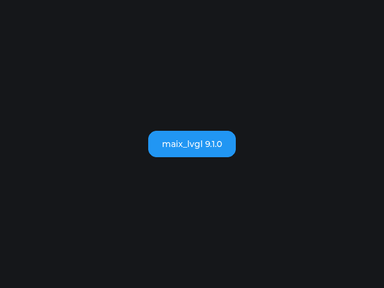
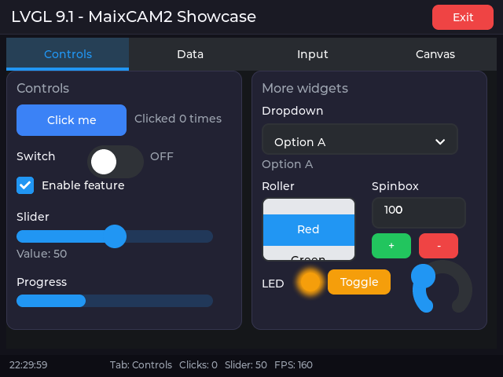
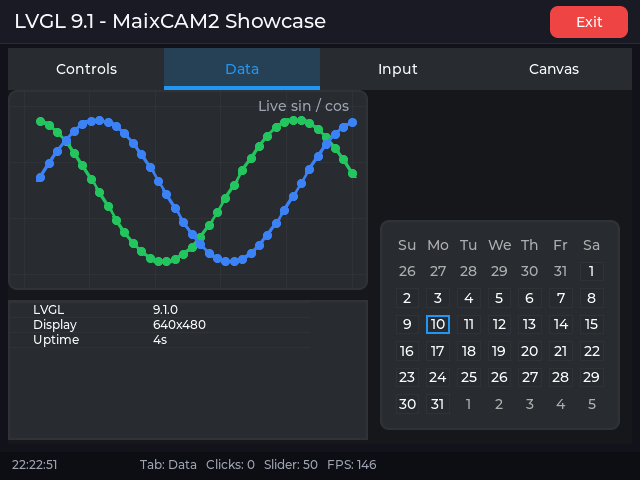
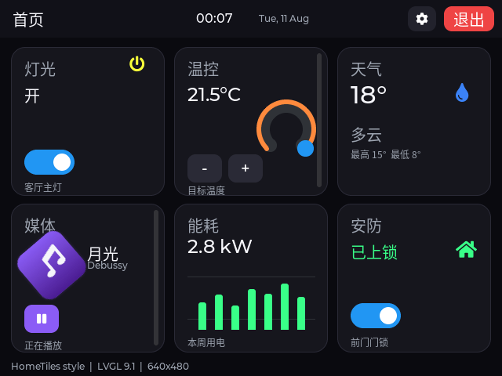
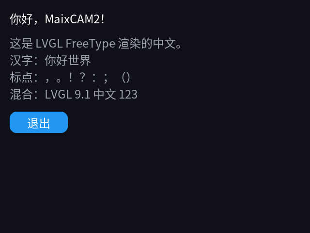

## Introduction

[LVGL](https://lvgl.io/) (Light and Versatile Graphics Library) is an open-source embedded graphics library. It makes it easy to build modern-looking UIs such as buttons, sliders, charts, calendars and drawing boards.

`maix_lvgl` provides the LVGL 9.1 Python bindings for MaixPy. Its API matches MicroPython's `lvgl` module (`import maix_lvgl as lv`), so most MicroPython LVGL tutorials and examples you find online can be used as is. It lets you use the full set of LVGL widgets and APIs from Python, without writing a single line of C.

`maix_lvgl` is an **independent Python package** (not a built-in MaixPy module). The package name is `maix-lvgl` and the import name is `maix_lvgl`. It currently supports:

| Platform | Architecture | Python version | Status |
| --- | --- | --- | --- |
| MaixCAM2 | aarch64 | 3.13 | Verified on hardware |
| MaixCAM / MaixCAM-Pro | RISC-V 64 | 3.11 | Wheel provided, not verified on hardware |
| Desktop Linux (SDL window) | x86_64 | 3.13 | For debugging the UI on a PC |
| Windows (SDL window) | x86_64 | 3.13 | For debugging the UI on a PC |

`maix_lvgl` renders through MaixPy's `display.Display` (640x480, BGRA8888 on MaixCAM2), and touch events come from `touchscreen.TouchScreen`, so using it feels exactly like writing any other MaixPy program.

## Download the Python package

### Option 1: download from PyPI (recommended)

When the device has network access, just install it with `pip`. `pip` downloads the wheel that matches the current platform and Python version automatically:

```bash
python3 -m pip install maix-lvgl
```

If the download is slow, you can switch pip to a mirror as described in [Add python packages](./python_pkgs.md).

### Option 2: download the wheel manually and copy it to the device

If the device has no network access, download the wheel on your PC first, then copy it to the device with MaixVision's file manager, for example into `/root`.

Release page: <https://github.com/Taoxuan-168/Maix_LVGL/releases>

| Device / platform | Wheel file to download |
| --- | --- |
| MaixCAM2 | `maix_lvgl-0.1.1-cp313-cp313-manylinux2014_aarch64.whl` |
| MaixCAM / MaixCAM-Pro | `maix_lvgl-0.1.1-cp311-cp311-musllinux_1_2_riscv64.whl` |
| Desktop Linux (x86_64) | `maix_lvgl-0.1.1-cp313-cp313-manylinux_2_28_x86_64.whl` |
| Windows (x86_64) | `maix_lvgl-0.1.1-cp313-cp313-win_amd64.whl` |

In the wheel file name, `cp313` means CPython 3.13, while `aarch64` / `riscv64` is the CPU architecture, so the file has to match your device. You can check the platform and Python version in the device terminal:

```bash
uname -m
python3 -V
```

> If the file does not match, pip reports `not a supported wheel`; download the right one based on the output above. MaixCAM / MaixCAM-Pro is RISC-V 64-bit with Python 3.11, MaixCAM2 is aarch64 with Python 3.13, do not mix them up. The exact file names may change between versions; check the Release page.

## Install the Python package

### Install online

When the device has network access, install with pip directly:

```bash
python3 -m pip install maix-lvgl
```

You can also install it from Python code in MaixVision:

```python
import os
os.system("python3 -m pip install maix-lvgl")
```

### Install offline

Copy the downloaded wheel to the device (for example into `/root`), then run:

```bash
python3 -m pip install --force-reinstall --no-deps /root/maix_lvgl-0.1.1-cp313-cp313-manylinux2014_aarch64.whl
```

* `--force-reinstall`: reinstall even if it is already installed, convenient for upgrading or overwriting.
* `--no-deps`: install only this package and skip resolving dependencies online.

### Verify the installation

Run this in the device terminal or in MaixVision:

```bash
python3 -c "import maix_lvgl as lv; print(lv.__version__)"
```

If it prints a version number (for example `0.1.1`), the installation succeeded.

## Basic demo: a button and a label

Create a `main.py` and run the following code in MaixVision:

```python
import time
from maix import app, display, touchscreen
import maix_lvgl as lv

disp = display.Display()
ts = touchscreen.TouchScreen()

try:
    lv.init(disp, ts)               # hand MaixPy's display and touchscreen to LVGL

    scr = lv.screen_active()        # the currently active screen
    btn = lv.button(scr)            # create a button on the screen
    btn.set_size(240, 120)          # a bigger button is easier to tap
    btn.center()

    label = lv.label(btn)           # put a label on the button
    label.set_text("Click me")      # the default font has no CJK glyphs, see "CJK text" below
    label.center()

    count = [0]

    def on_clicked(event):
        count[0] += 1
        label.set_text("Clicked %d" % count[0])
        print("clicked", count[0])

    btn.add_event_cb(on_clicked, lv.EVENT.CLICKED, None)   # register the click event

    while not app.need_exit():
        lv.timer_handler()          # run LVGL timers and refresh the UI, required
        time.sleep(0.005)           # yield the CPU
finally:
    lv.deinit()                     # release LVGL
    ts.close()
    disp.close()
```

After running, a button with a label appears in the middle of the screen. Tap it and the label shows the click count, while the terminal prints `clicked 1`, `clicked 2`, ...



### Key points

* `lv.init(disp, ts)`: hands MaixPy's `display.Display` object and `touchscreen.TouchScreen` object to LVGL. Afterwards LVGL draws to the screen directly and also handles touch input.
* `lv.screen_active()`: gets the currently active screen. Every new widget is created under a parent object (the screen or another widget).
* Widgets are created the same way as in the MicroPython binding: `lv.button(parent)`, `lv.label(parent)`, `lv.slider(parent)`, and method names such as `set_text`, `set_size`, `set_pos` and `center` are the same too.
* `add_event_cb(callback, lv.EVENT.CLICKED, None)`: registers a callback for a widget. Other common events are `lv.EVENT.VALUE_CHANGED` (slider or switch value changed) and `lv.EVENT.PRESSED` (pressed).
* The main loop **must** call `lv.timer_handler()`. It advances LVGL's tick, runs timers and refreshes the UI. The `maix_lvgl` `timer_handler` already advances the tick for you, so do not call the raw `lvgl.timer_handler()` instead, otherwise the UI stops refreshing and touch stops working.
* `time.sleep(0.005)` yields the CPU so the main loop does not occupy a whole core; around 5 ms is a good value.
* The default font (Montserrat) only contains Latin glyphs, so CJK text will not show up unless you load a font as described in "CJK text" below.
* Always call `lv.deinit()` when the program ends (exception path included), then close the touchscreen and display objects, otherwise the next run may fail to get the screen.

## More demos and examples

The `maix_lvgl` repository ships a set of complete examples under `examples/`, which you can copy to the device and run directly:

| Example | Contents |
| --- | --- |
| `demo.py` | Minimal button demo, essentially the code above |
| `showcase.py` | Four interactive pages: controls, charts/tables/calendar, text input and keyboard, canvas drawing and animations |
| `tile_dashboard.py` | Tile dashboard (light, climate, weather, media, energy and security cards) |
| `neon_dashboard.py` | Neon-style dashboard |
| `music_player.py` | Music player UI (rotating cover, progress bar, spectrum) |
| `watchface.py` | Round watch face, tap to switch themes |
| `threshold_editor.py` | Camera binary threshold editor |
| `multi_color_threshold.py` | Multi-color LAB threshold editor |
| `drawing_board.py` | Touch drawing board that can save a PNG |

Below is the Controls page of `showcase.py`, with buttons, switches, checkboxes, sliders, bars, arcs, dropdowns, rollers, spinboxes and LEDs:



The Data page contains a live sin/cos chart, a table and a calendar:



And a demo that looks more like a real application, `tile_dashboard.py`:



Copy the whole `examples` directory to the device (for example into `/root/examples`), because the examples share `_common.py`. Then open and run them in MaixVision, or execute in the terminal:

```bash
cd /root/examples
python3 showcase.py
```

> `showcase.py`, `tile_dashboard.py` and some other examples have an `Exit` button in the top-right corner of the UI, tap it to quit. For the others, use MaixVision's stop button.

## CJK text

LVGL's built-in fonts only cover Latin characters. To display Chinese (or other CJK text) you have to load a font. FreeType support is enabled in the `maix_lvgl` build, so you can load a font file from the device directly, for example the built-in `SourceHanSansCN-Regular.otf`:

```python
import time
from maix import app, display, touchscreen
import maix_lvgl as lv

FONT = "/maixapp/share/font/SourceHanSansCN-Regular.otf"

disp = display.Display()
ts = touchscreen.TouchScreen()
font = None

try:
    lv.init(disp, ts)
    scr = lv.screen_active()
    scr.set_style_bg_color(lv.color_hex(0x101018), 0)

    font = lv.freetype_font_create(FONT, 0, 24, 0)   # font, render mode, pixel size, style
    if font is None:
        raise RuntimeError("cannot load " + FONT)

    label = lv.label(scr)
    label.set_text("你好，MaixCAM2！")
    label.set_style_text_font(font, 0)
    label.set_style_text_color(lv.color_hex(0xFFFFFF), 0)
    label.set_pos(20, 20)

    while not app.need_exit():
        lv.timer_handler()
        time.sleep(0.005)
finally:
    if font is not None:
        font.freetype_font_delete()
    lv.deinit()
    ts.close()
    disp.close()
```



Notes:

* `lv.init()` already initializes FreeType and `lv.deinit()` cleans it up. Do **not** call `lv.freetype_init()` / `lv.freetype_uninit()` manually, otherwise the cleanup runs twice and may hang.
* Delete the widgets that use the font before calling `font.freetype_font_delete()`, otherwise you access a freed font.
* The Source Han Sans font file is about 8 MB, so create it on demand and delete it when you are done.

## Debug the UI on a PC (optional)

On desktop Linux / Windows the same package uses LVGL's SDL window instead of MaixPy's display, so you can tune the UI on your PC before running it on the device:

```python
import time
import maix_lvgl as lv

lv.init(800, 600)          # SDL window size

scr = lv.screen_active()
label = lv.label(scr)
label.set_text("Hello LVGL")
label.center()

try:
    while True:
        lv.timer_handler()
        time.sleep(0.01)
except KeyboardInterrupt:
    pass
finally:
    lv.deinit()
```

`maix_lvgl` detects the environment automatically: if `maix` can be imported (on the device) it uses MaixPy's display and touchscreen, otherwise it creates an SDL window with mouse and keyboard input.

> The desktop wheel targets x86_64 + Python 3.13; the PyPI Linux wheel requires glibc 2.28+ (Ubuntu 20.04+ / Debian 10+).

## Notes and known limitations

* **Exclusive display**: only one program can use the screen at a time. Quit the running app that occupies the screen before running an LVGL program.
* **Touch target**: taps must land on a widget, so the widget has to cover the area you actually touch; a widget that is too small or covered by another widget cannot be tapped.
* **JPEG images**: JPEG decoding is not compiled in the current version (upstream jpegio depends on LVGL 9.5 internals while this build uses LVGL 9.1.0), so JPEG images cannot be displayed directly.
* **CJK text**: the built-in font only has Latin glyphs, load a font with FreeType as shown above.
* **MaixCAM / MaixCAM-Pro**: the wheel is provided but has not been verified on hardware; issues and feedback are welcome at [issues](https://github.com/Taoxuan-168/Maix_LVGL/issues).

## References

* Source code, examples and changelog: <https://github.com/Taoxuan-168/Maix_LVGL>
* PyPI package page: <https://pypi.org/project/maix-lvgl/>
* LVGL documentation: <https://docs.lvgl.io/>
* LVGL examples (C language, but the concepts and widgets are the same): <https://docs.lvgl.io/master/examples.html>
* MicroPython LVGL binding (same API style): <https://github.com/lvgl/lv_binding_micropython>
