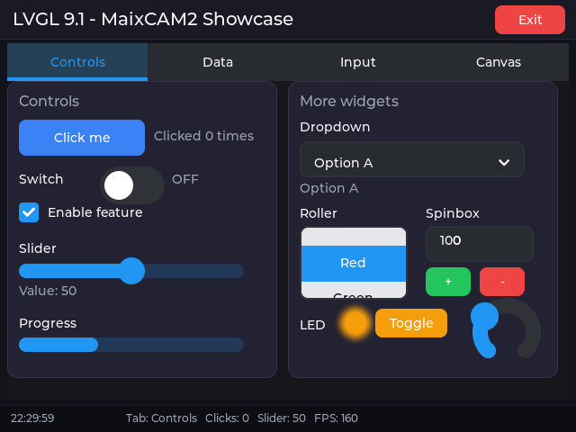
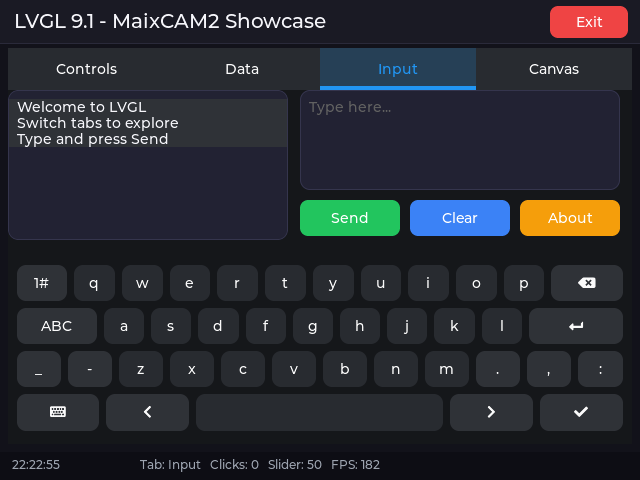
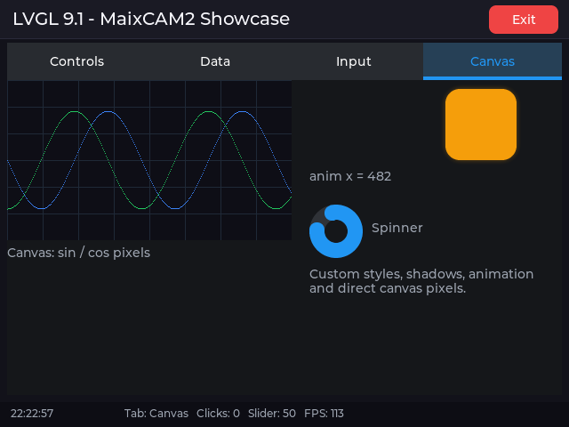
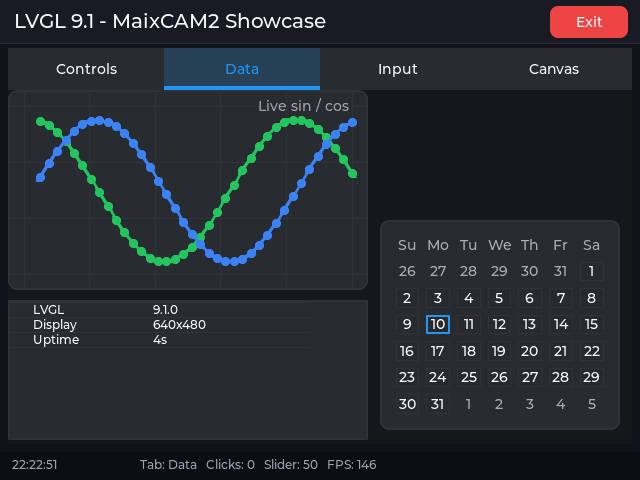
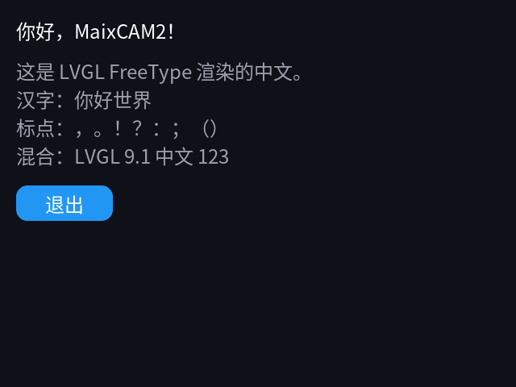
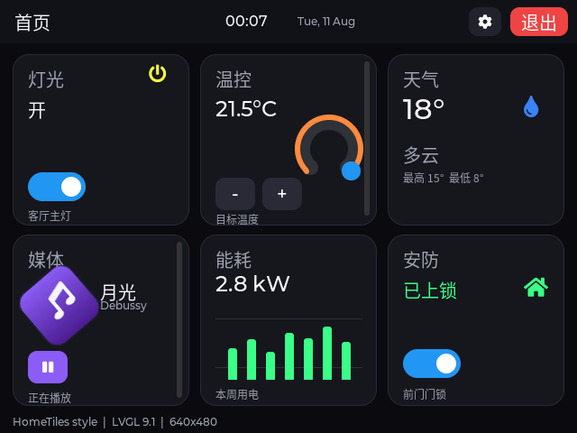
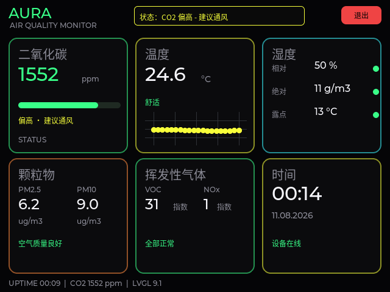
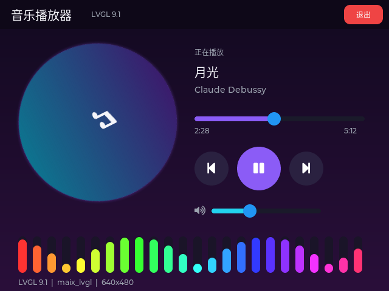
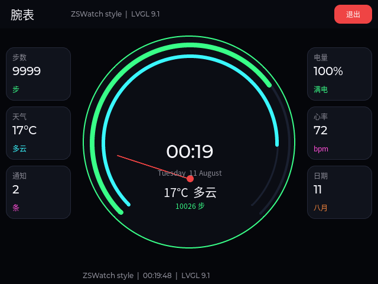

## What is maix_lvgl

`maix_lvgl` provides Python bindings for [LVGL 9.1](https://lvgl.io/) on MaixPy.
The API matches MicroPython's `lvgl` module, so existing examples work with
`import maix_lvgl as lv`.

It renders LVGL into a MaixPy `display.Display` and feeds
`touchscreen.TouchScreen` events into an LVGL pointer input device, so no
extra display driver code is needed on MaixCAM / MaixCAM2.



Highlights:

- Full LVGL 9.1 widget set: buttons, labels, sliders, switches, dropdowns,
  charts, canvas, keyboard, and more
- Styling: colors, radius, borders, shadows, gradients, fonts
- Layout: absolute positioning, alignment, Flex, Grid
- Events, timers, animations
- Per-pixel Canvas drawing and live Chart curves
- Runtime FreeType fonts, including Chinese text
- Plain Python main loop that composes with MaixPy camera, AI and networking

> Repository: <https://github.com/Taoxuan-168/Maix_LVGL>
>
> PyPI: <https://pypi.org/project/maix-lvgl/>

## Install

Install from PyPI on the device; pip selects the wheel for the platform:

```bash
python3 -m pip install maix-lvgl
```

Supported platforms:

| Device | Python | wheel tag |
| --- | --- | --- |
| MaixCAM2 | 3.13 | `cp313-cp313-manylinux2014_aarch64` |
| MaixCAM | 3.11 | `cp311-musllinux_1_2_riscv64` |

Prebuilt wheels are also available on GitHub Releases:

<https://github.com/Taoxuan-168/Maix_LVGL/releases>

Verify the installation:

```python
import maix_lvgl as lv
print(lv.__version__)
```

> Stop the launcher or enter development mode before running an LVGL program:
> only one program can use `maix.display.Display` at a time.

## Quick start

A complete example: create a screen, a button and a label, handle a click,
then run the LVGL loop.

```python
import time

from maix import app, display, touchscreen

import maix_lvgl as lv


def main():
    disp = display.Display()
    ts = touchscreen.TouchScreen()

    try:
        lv.init(disp, ts)

        scr = lv.screen_active()
        scr.set_style_bg_color(lv.color_hex(0x101018), 0)
        scr.set_style_bg_opa(lv.OPA.COVER, 0)

        btn = lv.button(scr)
        btn.set_size(240, 120)
        btn.center()
        btn.set_style_bg_color(lv.color_hex(0x2563EB), 0)
        btn.set_style_radius(16, 0)

        label = lv.label(btn)
        label.set_text("Hello MaixCAM2")
        label.center()
        label.set_style_text_color(lv.color_hex(0xFFFFFF), 0)

        def on_clicked(event):
            print("clicked")

        btn.add_event_cb(on_clicked, lv.EVENT.CLICKED, None)

        while not app.need_exit():
            lv.timer_handler()
            time.sleep(0.005)

    finally:
        lv.deinit()
        ts.close()
        disp.close()


if __name__ == "__main__":
    main()
```

Key points:

- `lv.init(disp, ts)` creates the LVGL display and pointer input device.
  Pass `False` as `ts` to run without touch.
- `lv.timer_handler()` advances the LVGL tick and processes timers, input and
  redraws. It replaces `lv_tick_inc()`; do not call the raw
  `lvgl.timer_handler()` directly.
- `lv.deinit()` releases LVGL and the drivers it created.
- `time.sleep(0.005)` yields the CPU; redraws are driven by `timer_handler()`.

## Core concepts

| Concept | Meaning |
| --- | --- |
| display | LVGL display device, created by `lv.init()` from the MaixPy display |
| screen | Root object, obtained with `lv.screen_active()` |
| widget / obj | A control such as `lv.button` or `lv.label`; first argument is its parent |
| style | Style properties set with `set_style_*`; second argument is a state selector |
| event | Callbacks registered with `add_event_cb()` |
| timer | LVGL timer created with `lv.timer_create()` |
| anim | Animation created with `lv.anim_t()` and started with `start()` |

LVGL uses a parent/child object tree: deleting a parent deletes its children.
Python variables are wrappers around native LVGL objects. Short-lived wrapper
variables do not stop a widget from being shown, but callbacks, animations,
timers and Canvas buffers must be kept alive from Python.

## Creating widgets

Every widget takes its parent as the first argument:

```python
scr = lv.screen_active()

label = lv.label(scr)
button = lv.button(scr)
slider = lv.slider(scr)
switch = lv.switch(scr)
chart = lv.chart(scr)
canvas = lv.canvas(scr)
```

Common widgets:

| Widget | Purpose |
| --- | --- |
| `lv.label` | Text |
| `lv.button` | Button |
| `lv.switch` / `lv.checkbox` | Switch / checkbox |
| `lv.slider` / `lv.bar` / `lv.arc` | Slider / progress bar / arc |
| `lv.dropdown` / `lv.roller` | Dropdown / roller |
| `lv.textarea` / `lv.keyboard` | Text input / on-screen keyboard |
| `lv.chart` | Line, bar and scatter charts |
| `lv.table` / `lv.calendar` | Table / calendar |
| `lv.canvas` | Per-pixel drawing |
| `lv.list` / `lv.msgbox` | List / message box |
| `lv.spinner` / `lv.led` | Spinner / LED indicator |

### Common widget operations

```python
label = lv.label(scr)
label.set_text("Temperature: 25.3 °C")
label.set_pos(20, 20)
label.set_style_text_color(lv.color_hex(0xE5E7EB), 0)
label.set_style_text_font(lv.font_montserrat_16, 0)

slider = lv.slider(scr)
slider.set_pos(20, 60)
slider.set_size(220, 16)
slider.set_range(0, 100)
slider.set_value(50, lv.ANIM_ENABLE.OFF)

bar = lv.bar(scr)
bar.set_pos(20, 100)
bar.set_size(220, 12)
bar.set_range(0, 100)
bar.set_value(65, lv.ANIM_ENABLE.OFF)

switch = lv.switch(scr)
switch.set_pos(20, 130)
switch.add_state(lv.STATE.CHECKED)
```



Pass `lv.ANIM_ENABLE.OFF` as the second `set_value()` argument to apply the
value immediately; `lv.ANIM_ENABLE.ON` animates the transition.

## Styles

Styles are applied directly to an object with `set_style_*` methods. The
second argument is the selector:

- `0`: main part (`LV_PART_MAIN`) in its default state
- `lv.STATE.PRESSED`: pressed state
- `lv.STATE.CHECKED`: checked state

### Color and opacity

```python
color = lv.color_hex(0x3B82F6)          # RGB
scr.set_style_bg_color(color, 0)
scr.set_style_bg_opa(lv.OPA.COVER, 0)   # fully opaque

panel.set_style_bg_opa(lv.OPA._70, 0)   # 70% opacity
```

`lv.OPA` provides `TRANSP`, `_10` through `_90`, and `COVER`.

### Radius, border and shadow

```python
card = lv.obj(scr)
card.set_size(220, 120)
card.set_style_bg_color(lv.color_hex(0x1E293B), 0)
card.set_style_bg_opa(lv.OPA.COVER, 0)
card.set_style_radius(14, 0)
card.set_style_border_width(1, 0)
card.set_style_border_color(lv.color_hex(0x334155), 0)
card.set_style_shadow_width(18, 0)
card.set_style_shadow_color(lv.color_hex(0x3B82F6), 0)
card.set_style_shadow_opa(lv.OPA._50, 0)
card.set_style_pad_all(12, 0)
```

### Gradient background

```python
card.set_style_bg_color(lv.color_hex(0x0F172A), 0)
card.set_style_bg_grad_color(lv.color_hex(0x1E3A8A), 0)
card.set_style_bg_grad_dir(lv.GRAD_DIR.VER, 0)
```

### Text style

```python
label.set_style_text_color(lv.color_hex(0xF8FAFC), 0)
label.set_style_text_font(lv.font_montserrat_20, 0)
label.set_style_text_letter_space(2, 0)
```

The built-in Montserrat fonts only cover Latin characters. Use FreeType for
Chinese text (see below).

### State-specific styles

The same object can have different styles per state:

```python
btn.set_style_bg_color(lv.color_hex(0x2563EB), 0)
btn.set_style_bg_color(lv.color_hex(0x1D4ED8), lv.STATE.PRESSED)
```

## Layout and alignment

### Absolute positioning

```python
obj.set_pos(x, y)
obj.set_x(x)
obj.set_y(y)
obj.set_size(width, height)
```

### Alignment

```python
obj.align(lv.ALIGN.CENTER, 0, 0)
obj.align(lv.ALIGN.TOP_RIGHT, -10, 10)
obj.center()
```

`lv.ALIGN` includes `TOP_LEFT`, `TOP_MID`, `CENTER`, `BOTTOM_RIGHT` and more.
The last two arguments are offsets from the aligned position.

### Flex layout

Flex arranges children in a row or column:

```python
row = lv.obj(scr)
row.set_size(400, 80)
row.set_flex_flow(lv.FLEX_FLOW.ROW)
row.set_flex_align(
    lv.FLEX_ALIGN.SPACE_EVENLY,
    lv.FLEX_ALIGN.CENTER,
    lv.FLEX_ALIGN.CENTER,
)

for text in ("A", "B", "C"):
    btn = lv.button(row)
    btn.set_size(80, 48)
    lv.label(btn).set_text(text)
```

### Grid layout

Grid suits table-like layouts. `set_grid_dsc_array()` takes column and row
sizes; the arrays must end with `LV_GRID_TEMPLATE_LAST` (not exported by the
binding; its value in LVGL 9.1 is `0x1FFFFFFF`):

```python
GRID_LAST = 0x1FFFFFFF  # LV_GRID_TEMPLATE_LAST

grid = lv.obj(scr)
grid.set_size(300, 200)
grid.set_grid_dsc_array(
    [lv.grid_fr(1), lv.grid_fr(1), GRID_LAST],
    [lv.grid_fr(1), lv.grid_fr(1), GRID_LAST],
)

item = lv.obj(grid)
item.set_grid_cell(lv.GRID_ALIGN.STRETCH, 0, 1, lv.GRID_ALIGN.STRETCH, 0, 1)
```

## Events

Event callbacks receive an `event_t`:

```python
def on_clicked(event):
    target = event.get_target_obj()
    print("clicked", target)

btn.add_event_cb(on_clicked, lv.EVENT.CLICKED, None)
```

Common events:

| Event | When it fires |
| --- | --- |
| `lv.EVENT.CLICKED` | Click |
| `lv.EVENT.PRESSED` / `RELEASED` | Press / release |
| `lv.EVENT.VALUE_CHANGED` | Value changed (slider, switch, dropdown) |
| `lv.EVENT.READY` | Action completed (keyboard, message box) |

Slider and switch:

```python
def on_value_changed(event):
    print("value:", slider.get_value())

slider.add_event_cb(on_value_changed, lv.EVENT.VALUE_CHANGED, None)


def on_switch_changed(event):
    print("switch:", switch.has_state(lv.STATE.CHECKED))

switch.add_event_cb(on_switch_changed, lv.EVENT.VALUE_CHANGED, None)
```

> Keep callback functions alive (module level, closure, or a list). Do not use
> a temporary lambda that is immediately discarded. The third argument to
> `add_event_cb` is user data; retrieve it with `event.get_user_data()`.

Remove a callback:

```python
btn.remove_event_cb(on_clicked)
```

## Timers and animations

### Timers

```python
def on_tick(timer):
    label.set_text(time.strftime("%H:%M:%S"))

timer = lv.timer_create(on_tick, 1000, None)  # every 1000 ms
```

`lv.timer_create(callback, period_ms, user_data)` starts the timer
automatically. Keep both the callback and the timer object referenced; call
`timer.delete()` when it is no longer needed.

### Animations

```python
box = lv.obj(scr)
box.set_size(80, 80)
box.set_style_bg_color(lv.color_hex(0xF59E0B), 0)
box.set_style_bg_opa(lv.OPA.COVER, 0)
box.set_style_radius(16, 0)

def exec_anim(anim, value):
    box.set_x(value)

anim = lv.anim_t()
anim.init()
anim.set_values(0, 240)
anim.set_time(1200)
anim.set_playback_time(1200)
anim.set_repeat_count(0xFFFF)   # loop forever
anim.set_custom_exec_cb(exec_anim)
anim.start()
```

`set_values(start, end)` sets the range, `set_time()` the forward duration and
`set_playback_time()` the reverse duration. Keep the `anim` object alive.

`maix_lvgl` also provides `lv.anim_set_exec_cb(anim, cb)` as a convenience
wrapper.

## Drawing

### Canvas: per-pixel drawing

`lv.canvas` gives direct access to pixels, useful for waveforms, gauges and
custom graphics:

```python
import math

WIDTH, HEIGHT = 320, 180
buffer = bytearray(WIDTH * HEIGHT * 4)   # ARGB8888

canvas = lv.canvas(scr)
canvas.set_size(WIDTH, HEIGHT)
canvas.set_buffer(buffer, WIDTH, HEIGHT, lv.COLOR_FORMAT.ARGB8888)
canvas.fill_bg(lv.color_hex(0x0E0E16), lv.OPA.COVER)

grid_color = lv.color_hex(0x1F2937)
for x in range(0, WIDTH, 40):
    for y in range(HEIGHT):
        canvas.set_px(x, y, grid_color, lv.OPA.COVER)

wave_color = lv.color_hex(0x3B82F6)
for x in range(WIDTH):
    y = int(HEIGHT / 2 + 55 * math.sin(x / 24.0))
    if 0 <= y < HEIGHT:
        canvas.set_px(x, y, wave_color, lv.OPA.COVER)
```



Notes:

- The buffer must be a `bytearray` with `ARGB8888` pixels.
- **Keep a Python reference to the buffer** (module-level variable or a list);
  otherwise it may be collected and the canvas shows garbage or crashes.
- Buffer size is `width * height * 4`.
- LVGL refreshes the canvas on the next redraw.

### Chart: live curves

```python
import math

chart = lv.chart(scr)
chart.set_size(360, 200)
chart.set_type(lv.chart.TYPE.LINE)
chart.set_point_count(40)
chart.set_range(lv.chart.AXIS.PRIMARY_Y, -100, 100)
chart.set_div_line_count(4, 6)
chart.set_update_mode(lv.chart.UPDATE_MODE.SHIFT)

series = chart.add_series(lv.color_hex(0x22C55E), lv.chart.AXIS.PRIMARY_Y)

for i in range(40):
    chart.set_next_value(series, int(80 * math.sin(i / 5.0)))
```



`set_update_mode(lv.chart.UPDATE_MODE.SHIFT)` shifts old points out as new
ones arrive, which suits live data. Use `lv.chart.TYPE.BAR` for bar charts.

### Drawing with styles

Many visual effects do not need Canvas at all:

- Borders: `set_style_border_width()` + `set_style_border_color()`
- Rounded corners: `set_style_radius()`
- Shadows/glow: `set_style_shadow_width()` + `set_style_shadow_color()` +
  `set_style_shadow_opa()`
- Gradients: `set_style_bg_grad_color()` + `set_style_bg_grad_dir()`
- Arcs and progress: `lv.arc`, `lv.bar`

```python
ring = lv.arc(scr)
ring.set_size(120, 120)
ring.set_bg_angles(0, 360)
ring.set_angles(0, 270)
ring.set_style_arc_color(lv.color_hex(0x22C55E), lv.PART.INDICATOR)
ring.set_style_arc_width(10, lv.PART.INDICATOR)
```

### Chinese text with FreeType

The built-in Montserrat fonts only contain Latin glyphs. Load a system font at
runtime with FreeType:

```python
FONT = "/maixapp/share/font/SourceHanSansCN-Regular.otf"

font = lv.freetype_font_create(FONT, 0, 24, 0)
if font is None:
    raise RuntimeError("cannot load " + FONT)

label = lv.label(scr)
label.set_text("你好，MaixCAM2！")
label.set_style_text_font(font, 0)
label.set_pos(20, 20)

# Delete widgets that use the font before deleting the font itself.
label.delete()
font.freetype_font_delete()
```



Notes:

- `lv.init()` already initializes FreeType and `lv.deinit()` cleans it up.
  Do not call `lv.freetype_init()` / `lv.freetype_uninit()` manually, or
  cleanup may run twice and hang.
- Delete widgets using the font first, then call `font.freetype_font_delete()`.
- The Source Han font is about 8 MB; create it on demand. The glyph cache is
  controlled by `LV_FREETYPE_CACHE_SIZE`.

### Images

`lv.image` displays images; `set_src()` accepts an image descriptor or a path.
For MaixPy camera frames, wrap an `ARGB8888`/`BGRA8888` buffer in an
`lv_image_dsc_t`:

```python
dsc = lv.image_dsc_t()
dsc.header.w = width
dsc.header.h = height
dsc.header.cf = lv.COLOR_FORMAT.ARGB8888
dsc.data_size = len(buffer)
dsc.data = buffer

img = lv.image(scr)
img.set_src(dsc)
```

> Keep the `data` buffer alive. If you start from a MaixPy `image`, convert it
> to BGRA8888 first and keep the resulting bytes. See
> `examples/showcase.py` and `examples/music_player.py` for complete examples.

## Combining with MaixPy

`maix_lvgl` only handles the UI; use MaixPy modules for camera, AI and
networking. A typical loop:

```python
from maix import app, camera, display, touchscreen
import maix_lvgl as lv

cam = camera.Camera(320, 240)
disp = display.Display()
ts = touchscreen.TouchScreen()

lv.init(disp, ts)
# ... build the UI ...

while not app.need_exit():
    img = cam.read()
    # pass img to AI or networking, then update LVGL widgets with the result
    lv.timer_handler()
    time.sleep(0.005)
```

Camera reads and LVGL run serially on the main loop; avoid touching LVGL from
another thread.

## Performance and notes

- **Full-screen buffer**: `DisplayDriver` uses a full-screen
  `width * height * 4` byte buffer (about 1.2 MB at 640×480) with `FULL`
  render mode and pushes the whole frame on flush.
- **Main loop**: call `lv.timer_handler()` then `sleep(0.005)`. LVGL only
  redraws when something changes.
- **Object lifetime**: keep callbacks, animations, timers and canvas buffers
  referenced from Python.
- **Touch targets**: hit testing uses the widget's actual area; widgets must
  cover the touched region.
- **Single display**: only one program can use `maix.display.Display` at a
  time; stop the launcher before running.
- **Font cache**: the FreeType glyph cache is limited; switching many large
  sizes can increase memory use.

## Building maix_lvgl from source (brief)

`maix_lvgl` is a standard MaixCDK project. LVGL source is not vendored; MaixCDK
downloads and builds the version pinned by its Kconfig.

Flow:

1. MaixCDK downloads and builds LVGL 9.1.0 with its dependencies (FreeType,
   rlottie, ...).
2. `tools/regenerate_binding.py` runs the bundled omnipython-lvgl generator
   against MaixCDK's LVGL headers to produce `binding/lvgl_python.c` and
   `binding/lvgl.pyi`.
3. `components/lvgl_binding` compiles the generated code plus
   `runtime/lvpy_runtime.c` into `liblvgl_binding.so`, linked against MaixCDK's
   LVGL and Python.
4. `setup.py` packages the extension, the Python backend and dependencies into
   a platform wheel.

Build commands:

```bash
export MAIXCDK_PATH=/path/to/MaixCDK

# MaixCAM2: aarch64 / Python 3.13
python3.13 setup.py bdist_wheel --board maixcam2

# MaixCAM: RISC-V / Python 3.11
python3.11 setup.py bdist_wheel --board maixcam
```

Requirements: MaixCDK, the matching host Python (3.13 or 3.11), `pycparser`,
`cmake` and the target cross toolchain. Artifacts land in `dist/`:

```text
maix_lvgl-0.1.0-cp313-cp313-manylinux2014_aarch64.whl
maix_lvgl-0.1.0-cp311-cp311-musllinux_1_2_riscv64.whl
```

See `README.md` and `docs/PUBLISHING.md` in the repository for the full build,
binding-regeneration and release instructions.

## Examples and repository

Repository: <https://github.com/Taoxuan-168/Maix_LVGL>

| Example | Content |
| --- | --- |
| `examples/demo.py` | Minimal button demo |
| `examples/showcase.py` | Four pages: controls, charts, input, Canvas |
| `examples/tile_dashboard.py` | Smart-home tile dashboard |
| `examples/neon_dashboard.py` | Neon instrument panel |
| `examples/music_player.py` | Music player with spectrum |
| `examples/watchface.py` | Round watchface |
| `tests/suite_*.py` | On-device API test suites |

### UI examples









Run an example on the device:

```bash
python examples/showcase.py
```

Use the on-screen **Exit** button to quit.
