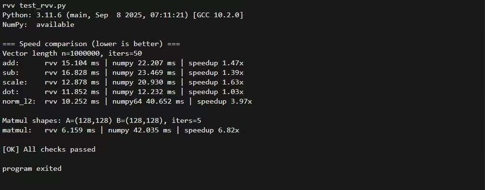

## Introduction

MaixPy ships an `rvv` Python extension module that hardware-accelerates NumPy-compatible vector and matrix operations on platforms with the RISC-V Vector extension (RVV), such as SG2002 / C906FDV. On platforms without RVV it falls back to a scalar implementation automatically.

- **Module name**: `rvv`
- **Target platform**: SG2002 / C906FDV with RVV 0.7.1
- **Data type**: `float32` only
- **Design goals**:
  - Accept NumPy `ndarray` or any object implementing the buffer protocol
  - Convert inputs internally to the `float32` + C-contiguous buffers the kernel expects
  - Return `numpy.ndarray` when NumPy is available (pybind11 `py::array_t<float>`)
  - Provide a scalar fallback so the same source can be built and tested on non-RISC-V hosts

Source code and release notes: [yangwenjie1231/sg2002_rvv](https://github.com/yangwenjie1231/sg2002_rvv).

## Installation

Install the prebuilt wheel on MaixCAM:

```bash
pip install --force-reinstall ./clib/rvv-0.1.3-py3-none-any.whl
```

You can then check whether RVV acceleration is available, and fall back to CPU computation when it is not:

```python
try:
    import rvv
    # Check that the rvv module exposes the required functions
    if hasattr(rvv, 'add') and hasattr(rvv, 'sub') and hasattr(rvv, 'norm_l2'):
        _RVV_AVAILABLE = True
        print("✓ RVV hardware acceleration available")
    else:
        _RVV_AVAILABLE = False
        rvv = None
        print("⚠ rvv module found but missing required functions, falling back to CPU")
except ImportError:
    _RVV_AVAILABLE = False
    rvv = None
    print("⚠ rvv module unavailable, falling back to CPU")
```

> **Note**: the wheel itself does not depend on NumPy (`install_requires=[]`). However, passing `numpy.ndarray` inputs, or running comparison tests against NumPy, requires NumPy to be installed in the target environment. On embedded Linux, building or installing NumPy is usually not possible.

## Performance comparison



On SG2002, element-wise operations such as `add` / `sub` / `scale` show the clearest RVV gains. Whether `matmul` beats NumPy depends on whether NumPy is linked against a high-performance BLAS — embedded NumPy builds usually are not, or perform poorly.

## Input data model

All `rvv` functions read their inputs through the **buffer protocol** (PEP 3118).

### Supported input types

- `numpy.ndarray(dtype=np.float32)`
- Other objects implementing the buffer protocol (some tensor libraries, custom buffers)

### Hard requirements

- **dtype must be float32**
  - PEP 3118 `format == 'f'`
  - `itemsize == 4`
- **Must be C-contiguous (row-major contiguous)**
  - Non-contiguous or sliced views (strides that do not describe a contiguous layout) raise an exception

### Automatic conversion

The internal `as_f32_buffer()` tries the NumPy path first:

- `py::array_t<float, c_style | forcecast>`

This means:

- When NumPy is available, `float64` or non-contiguous arrays are copied/converted to contiguous `float32` before computation.
- When NumPy is unavailable, only the generic buffer path is used, and inputs that violate the requirements above raise an error immediately.

For zero-copy behaviour and best performance, make sure the input already satisfies the requirements:

```python
x = np.ascontiguousarray(x, dtype=np.float32)
```

## API reference

The top-level module is named `rvv` and provides the following functions:

| Function | Description |
| --- | --- |
| `rvv.add(a, b)` | 1-D element-wise addition |
| `rvv.sub(a, b)` | 1-D element-wise subtraction |
| `rvv.scale(a, k)` | 1-D vector scaled by a scalar |
| `rvv.dot(a, b)` | 1-D dot product (inner product) |
| `rvv.norm_l2(a)` | 1-D L2 norm |
| `rvv.matmul(A, B)` | 2-D matrix multiplication |

### rvv.add(a, b) -> ndarray[float32]

**What it does**: element-wise addition.

**Parameters**:

- `a`: 1-D float32 buffer (expected `ndim=1`)
- `b`: 1-D float32 buffer (expected `ndim=1`)

**Returns**: a 1-D `float32` array with the same length as `a`

**Errors**:

- `ValueError`
  - `a` or `b` is not 1-D: `a must have ndim=1, got ndim=...`
  - `a` and `b` have different lengths: `add: a and b must have the same length`
  - input is not C-contiguous: `a must be C-contiguous float32 buffer`
- `TypeError`: input is not float32 (`format != 'f'` or `itemsize != 4`)

**Example**:

```python
import numpy as np
import rvv

a = np.arange(8, dtype=np.float32)
b = np.ones(8, dtype=np.float32)
print(rvv.add(a, b))
```

### rvv.sub(a, b) -> ndarray[float32]

**What it does**: element-wise subtraction, i.e. `out[i] = a[i] - b[i]`.

Parameters, return value and errors are the same as `add`; the two vectors must have equal length.

```python
import numpy as np
import rvv

a = np.arange(8, dtype=np.float32)
b = np.ones(8, dtype=np.float32)
print(rvv.sub(a, b))
```

### rvv.scale(a, k) -> ndarray[float32]

**What it does**: scales a vector by a scalar.

**Parameters**:

- `a`: 1-D float32 buffer
- `k`: Python `float`

**Returns**: a 1-D float32 array

**Errors**: `ValueError` / `TypeError`, validated the same way as `add`

```python
import numpy as np
import rvv

a = np.arange(8, dtype=np.float32)
print(rvv.scale(a, 0.5))
```

### rvv.dot(a, b) -> float

**What it does**: dot product (inner product), i.e. `sum_i a[i] * b[i]`.

**Parameters**:

- `a`: 1-D float32 buffer
- `b`: 1-D float32 buffer

**Returns**: a Python `float`

**Errors**:

- `ValueError`: length mismatch, `dot: a and b must have the same length`
- dtype / contiguity / ndim errors as above

```python
import numpy as np
import rvv

a = np.arange(8, dtype=np.float32)
print(rvv.dot(a, a))
```

### rvv.norm_l2(a) -> float

**What it does**: L2 (Euclidean) norm, defined as `sqrt(dot(a, a))`.

**Parameters**: `a`: 1-D float32 buffer

**Returns**: a Python `float`

**A note on numerical error**: `dot` and `norm_l2` are reduction operations. For very large vectors (for example 1e6 elements), different reduction orders (RVV blocking, scalar loops, NumPy/BLAS vectorisation) can produce a **very small relative error** compared with NumPy. Compare with a relative tolerance (for example `1e-4 ~ 1e-3`) rather than strict equality.

```python
import numpy as np
import rvv

a = np.random.randn(1000000).astype(np.float32)
print(rvv.norm_l2(a))
```

### rvv.matmul(A, B) -> ndarray[float32]

**What it does**: matrix multiplication.

- Input: `A` of shape `(m, k)`, `B` of shape `(k, n)`
- Output: `C` of shape `(m, n)`

**Parameters**:

- `A`: 2-D float32 buffer (`ndim=2`, C-contiguous, row-major)
- `B`: 2-D float32 buffer (`ndim=2`, C-contiguous, row-major)

**Returns**: a 2-D float32 array

**Errors**:

- `ValueError`
  - dimension is not 2: `A must have ndim=2, got ndim=...`
  - shape mismatch: `matmul: shape mismatch: A is (m,k) but B is (k2,n)`

```python
import numpy as np
import rvv

A = np.random.randn(2, 3).astype(np.float32)
B = np.random.randn(3, 4).astype(np.float32)
C = rvv.matmul(A, B)
print(C.shape)
```

### Combined example

```python
import numpy as np
import rvv

a = np.arange(8, dtype=np.float32)
b = np.arange(8, dtype=np.float32)

print(rvv.add(a, b))
print(rvv.sub(a, b))
print(rvv.scale(a, 2.0))
print(rvv.dot(a, b))
print(rvv.norm_l2(a))

A = np.arange(6, dtype=np.float32).reshape(2, 3)
B = np.arange(12, dtype=np.float32).reshape(3, 4)
print(rvv.matmul(A, B))
```

## Common errors

### `... must be float32-compatible buffer ...`

The input is not float32. Fix:

```python
x = x.astype(np.float32, copy=False)
```

### `... must be C-contiguous float32 buffer`

The input is a non-contiguous view, such as a slice or a transpose. Fix:

```python
x = np.ascontiguousarray(x, dtype=np.float32)
```

### `add/sub/dot: a and b must have the same length`

The two vectors have different lengths.

## Performance tips

- Make sure inputs are **float32** and **C-contiguous** to avoid unnecessary copies.
- On large arrays, `add` / `sub` / `scale` are where RVV gains show up most clearly.
- Whether `matmul` beats NumPy depends on whether NumPy is linked against a high-performance BLAS — embedded NumPy builds usually are not, or perform poorly.

## Building from source

This section is for users who need to build the module on SG2002 themselves, or to develop on top of it.

### Implementation map

- Python bindings: `rvv_ext/main/src/bind_rvv.cpp`
- C++ public interface declarations: `rvv_ext/main/include/rvv.hpp`
- RVV 0.7.1 implementation: `rvv_ext/main/src/rvv_rvv071.cpp` (compiled only when `__riscv_vector` is defined)
- Scalar implementation: `rvv_ext/main/src/rvv_scalar.cpp`

### Choosing a build mode: cross-compile (MaixCAM) vs host test (Linux)

`main/CMakeLists.txt` supports two build modes:

- **Cross-compile to SG2002 (recommended)**: enable `MaixCam`
  - Enables the RVV ISA flags (such as `-march=rv64imafdcv0p7xthead`)
  - Links against the SDK's `python3_lib_maixcam_musl_3.11.6` headers/libraries, avoiding a missing `Python.h`
- **Host Linux test**: enable `Linux`
  - Tries the system `Python.h` first (`python3-dev`), then falls back to the SDK python component

The target Python is **3.11.6** (SDK component `python3_lib_maixcam_musl_3.11.6`).

> If you see `fatal error: Python.h: No such file or directory`, the current build mode did not pick up the Python development headers.

### Build caveats

- Always run the build from the project root `rvv_ext/`, not from `rvv_ext/main/`. Otherwise the configuration is generated under `rvv_ext/main/build/...` and the output looks like an infinite loop.
- The `MY_SDK_PATH` environment variable must be set, otherwise the build reports a missing `/tools/cmds`.
- When cross-compiling, `TOOLCHAIN_PATH` **must be an absolute path**, otherwise CMake reports `TOOLCHAIN_PATH set error: ...`.
- `distclean` removes `build/`, after which `cmake --build build ...` fails with `Error: could not load cache`. You must re-run `python3 project.py build` to regenerate `build/CMakeCache.txt` first.
- NumPy usually **cannot be built or installed** on embedded Linux. This library's wheel does not depend on NumPy, but comparing results or speed against NumPy requires NumPy in the target environment.
- `norm_l2` / `dot` can differ slightly from NumPy on very large vectors (for example 1e6) due to floating-point error from reduction ordering. Compare with a relative tolerance, not strict equality.

### Building with Auto-bind-Python-from-CC--main

This project uses the same build system as `Auto-bind-Python-from-CC--main/examples/demo`.

**0) Set the SDK environment variable (required)**

```bash
export MY_SDK_PATH=/root/xmusic/Auto-bind-Python-from-CC--main/Auto-bind-Python-from-CC--main
```

**1) Open menuconfig**

```bash
cd /root/xmusic/rvv_ext
python3 project.py menuconfig
```

**2) Configure the toolchain (cross-compiling to SG2002)**

- `-mcpu=c906fdv`
- `-march=rv64imafdcv0p7xthead`
- `-mcmodel=medany`
- `-mabi=lp64d`

You can also configure without menuconfig by passing flags:

```bash
python3 project.py config \
  --toolchain /root/xmusic/host-tools/gcc/riscv64-linux-musl-x86_64/bin \
  --toolchain-prefix riscv64-unknown-linux-musl-
```

Or by using the environment variable read by the project's top-level `CMakeLists.txt`:

```bash
export MY_TOOLCHAIN_PATH=/root/xmusic/toolchains/maixcam/host-tools/gcc/riscv64-linux-musl-x86_64/bin
```

**3) Build and produce the wheel**

```bash
python3 project.py build
```

Artifacts:

- Compiled extension: `build/main/libmain.so`
- Wheel: `dist/*.whl`

**4) Verify RVV is enabled (optional)**

After `python3 project.py build`, check whether the compile command lines in the build log contain:

- `-march=rv64imafdcv0p7xthead`

If the flag is present, `__riscv_vector` should be defined and the RVV implementation (`rvv_rvv071.cpp`) is compiled into the library.

### IDE code completion

`rvv` is a binary extension module (`rvv.so`), so an IDE cannot infer function signatures from source the way it can for pure Python. The project provides type hints through **PEP 561**:

- `rvv_ext/rvv.pyi`: module stub providing signatures and docs for `add/sub/scale/dot/norm_l2/matmul`
- `rvv_ext/py.typed`: marker file telling tools and IDEs that the package ships type information

Both are included in the wheel (see `rvv_ext/setup.py`).

**Option A: install the wheel to get completion (recommended)**

```bash
pip install --no-deps --force-reinstall dist/*.whl
```

**Option B: get completion while developing directly in the source tree**

- Make sure your IDE's interpreter/project index can see `rvv_ext/rvv.pyi`
- In PyCharm, mark `rvv_ext/` as **Sources Root** (or add it to `PYTHONPATH`)

> Either way, the runtime import is still `import rvv`.

### Testing

Tests live in `rvv_ext/tests` and require NumPy plus pytest:

```bash
pytest -q
```

A performance comparison script that does not depend on pytest:

```bash
python3 tests/test_rvv.py
```

On SG2002 you can also run the micro-benchmark:

```bash
python3 tests/bench_perf.py
```

### Troubleshooting

**`Error: could not load cache`**

Raised by `cmake --build build ...` when the CMake cache (`build/CMakeCache.txt`) is missing. Common causes:

- You ran `python3 project.py distclean` and did **not** re-run the CMake configure step afterwards
- The `build/` directory was deleted or is empty

Fix:

```bash
cd /path/to/rvv_ext

# Re-run configure (generates build/CMakeCache.txt)
python3 project.py build

# Then compile
cmake --build build --target main -- -j"$(nproc)"
```

**`setup.py` reports `Native library not found: build/main/libmain.so`**

This means the extension has not been built yet, or it was built into a different directory. Check with:

```bash
find build -maxdepth 4 -name 'libmain.so' -o -name '*.so' | sort
```

If `libmain.so` exists but is not under `build/main/`, adjust `SO_FILE_PATH` in `setup.py` accordingly.

### Copy-paste commands (embedded Linux)

```bash
cd /path/to/rvv_ext            # adjust to your real path

# (Optional) full clean: removes build/ and CMakeCache.txt
python3 project.py distclean

# 1) Configure CMake (re-creates build/ and build/CMakeCache.txt)
python3 project.py build

# Sanity check (should exist after configure)
ls -la build/CMakeCache.txt

# 2) Compile the extension shared library (creates build/main/libmain.so)
cmake --build build --target main -- -j"$(nproc)"

# Sanity check (should exist after compile)
ls -la build/main/libmain.so

# 3) Build the wheel (creates dist/*.whl)
python3 setup.py bdist_wheel

# 4) List the wheel
ls -la dist
```

> If you only want to remove compiled objects but keep the CMake cache, prefer `python3 project.py clean` over `distclean`.

## License

This project is licensed under LGPL-3.0. See the LICENSE file in the repository for details.

Copyright (C) 2026 ywj &lt;yangwenjie1231@qq.com&gt;
