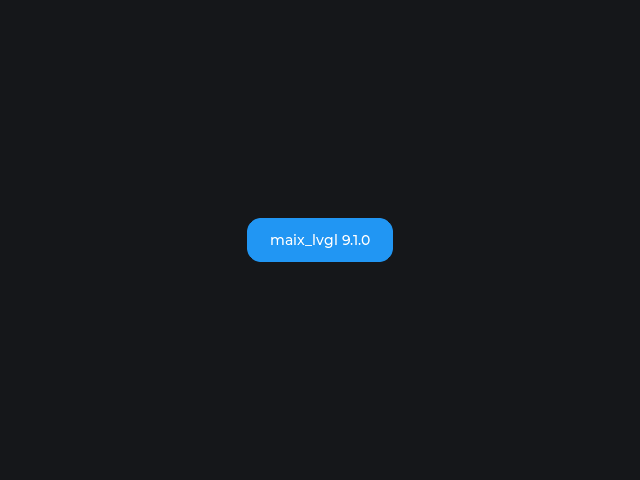
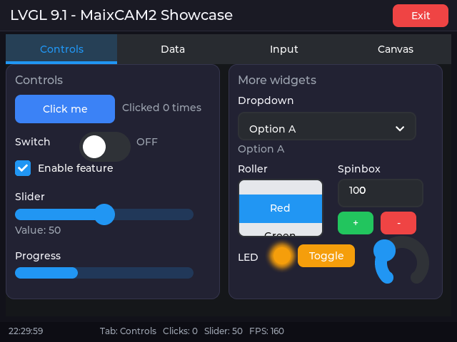
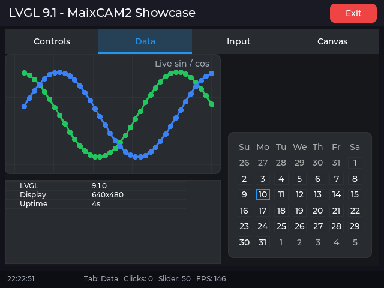
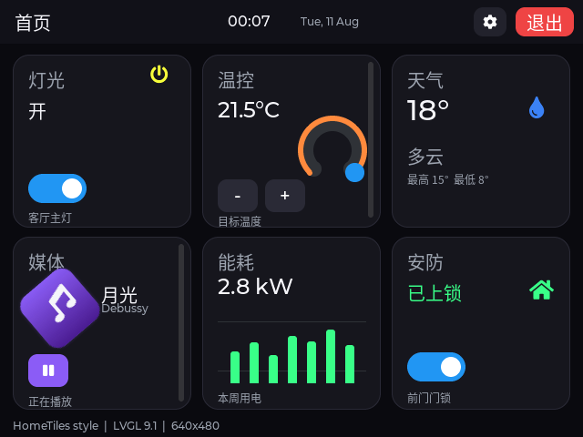
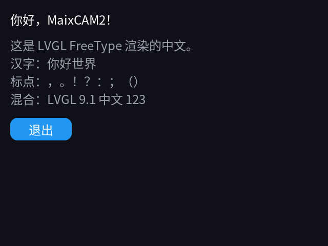

## 简介

[LVGL](https://lvgl.io/)（Light and Versatile Graphics Library）是一个开源的嵌入式图形库，可以很方便地做出按钮、滑块、图表、日历、画板等现代风格的界面。

`maix_lvgl` 是面向 MaixPy 的 LVGL 9.1 Python 绑定，使用方式和 MicroPython 的 `lvgl` 模块一致（`import maix_lvgl as lv`），因此在网上找到的 MicroPython LVGL 教程和示例大多可以直接参考。它让 Python 也能直接使用 LVGL 完整的控件和 API，不用写一行 C 代码。

`maix_lvgl` 是一个**独立的 Python 包**（不是 MaixPy 内置模块），包名 `maix-lvgl`，导入名 `maix_lvgl`，目前支持：

| 平台 | 架构 | Python 版本 | 状态 |
| --- | --- | --- | --- |
| MaixCAM2 | aarch64 | 3.13 | 已实机验证 |
| MaixCAM / MaixCAM-Pro | RISC-V 64 | 3.11 | 已提供 wheel，未实机验证 |
| 桌面 Linux（SDL 窗口） | x86_64 | 3.13 | 用于在电脑上调试界面 |
| Windows（SDL 窗口） | x86_64 | 3.13 | 用于在电脑上调试界面 |

`maix_lvgl` 直接通过 MaixPy 的 `display.Display` 把 LVGL 画面输出到屏幕（MaixCAM2 上为 640x480，BGRA8888），触摸事件则由 `touchscreen.TouchScreen` 交给 LVGL 处理，所以用法和写普通 MaixPy 程序一样。

## 下载 Python 包

### 方式一：从 PyPI 下载（推荐）

设备联网时，直接用 `pip` 安装即可，`pip` 会自动下载与当前设备平台、Python 版本匹配的 wheel 包：

```bash
python3 -m pip install maix-lvgl
```

如果下载速度慢，可以按[添加额外的 Python 包](./python_pkgs.md)中介绍的方法把 pip 换成国内的镜像源。

### 方式二：手动下载 wheel 再传到设备

设备不方便联网时，可以在电脑上先下载 wheel 文件，再通过 MaixVision 的「文件管理」把它传到设备上，比如放到设备的 `/root` 目录。

Release 页面：<https://github.com/Taoxuan-168/Maix_LVGL/releases>

| 设备 / 平台 | 需要下载的 wheel 文件 |
| --- | --- |
| MaixCAM2 | `maix_lvgl-0.1.1-cp313-cp313-manylinux2014_aarch64.whl` |
| MaixCAM / MaixCAM-Pro | `maix_lvgl-0.1.1-cp311-cp311-musllinux_1_2_riscv64.whl` |
| 桌面 Linux（x86_64） | `maix_lvgl-0.1.1-cp313-cp313-manylinux_2_28_x86_64.whl` |
| Windows（x86_64） | `maix_lvgl-0.1.1-cp313-cp313-win_amd64.whl` |

wheel 文件名里的 `cp313` 表示 CPython 3.13，`aarch64` / `riscv64` 表示 CPU 架构，下载时要和设备对得上。可以在设备终端中确认自己的平台和 Python 版本：

```bash
uname -m
python3 -V
```

> 装错了会提示 `not a supported wheel`，此时对照上面的命令输出重新下载对应文件即可。MaixCAM / MaixCAM-Pro 是 RISC-V 64 位 + Python 3.11，MaixCAM2 是 aarch64 + Python 3.13，不要混用。不同版本的文件名可能略有不同，以 Release 页面上的文件名为准。

## 安装 Python 包

### 在线安装

设备联网时，直接用 pip 安装：

```bash
python3 -m pip install maix-lvgl
```

也可以在 MaixVision 里用 Python 代码安装：

```python
import os
os.system("python3 -m pip install maix-lvgl")
```

### 离线安装

把下载好的 wheel 传到设备（比如 `/root`），然后执行：

```bash
python3 -m pip install --force-reinstall --no-deps /root/maix_lvgl-0.1.1-cp313-cp313-manylinux2014_aarch64.whl
```

* `--force-reinstall`：即使已经装过也重新安装，方便升级或覆盖。
* `--no-deps`：只安装这个包本身，不去联网解析依赖。

### 验证安装

在设备终端或 MaixVision 中运行：

```bash
python3 -c "import maix_lvgl as lv; print(lv.__version__)"
```

能打印出版本号（比如 `0.1.1`）就说明安装成功了。

## 基础演示：按钮和标签

新建一个 `main.py`，在 MaixVision 中运行下面的代码：

```python
import time
from maix import app, display, touchscreen
import maix_lvgl as lv

disp = display.Display()
ts = touchscreen.TouchScreen()

try:
    lv.init(disp, ts)               # 把 MaixPy 的屏幕和触摸屏交给 LVGL

    scr = lv.screen_active()        # 当前的活动屏幕
    btn = lv.button(scr)            # 在屏幕上创建一个按钮
    btn.set_size(240, 120)          # 按钮大一点，方便点击
    btn.center()

    label = lv.label(btn)           # 按钮上放一个标签
    label.set_text("Click me")      # 注意：默认字体没有中文字形，中文见下文「显示中文」
    label.center()

    count = [0]

    def on_clicked(event):
        count[0] += 1
        label.set_text("Clicked %d" % count[0])
        print("clicked", count[0])

    btn.add_event_cb(on_clicked, lv.EVENT.CLICKED, None)   # 注册点击事件

    while not app.need_exit():
        lv.timer_handler()          # 处理 LVGL 的定时器和界面刷新，必须调用
        time.sleep(0.005)           # 让出 CPU
finally:
    lv.deinit()                     # 释放 LVGL
    ts.close()
    disp.close()
```

运行后屏幕中间会出现一个按钮和一个标签，点击按钮，标签上的文字会变成点击次数，同时终端会打印 `clicked 1`、`clicked 2`……



### 关键点说明

* `lv.init(disp, ts)`：把 MaixPy 的 `display.Display` 对象和 `touchscreen.TouchScreen` 对象交给 LVGL，之后 LVGL 直接往屏幕上绘制，触摸事件也由 LVGL 处理。
* `lv.screen_active()`：获取当前的活动屏幕。新建的控件都挂在某个父对象（屏幕或其它控件）下面。
* 控件的创建方式与 MicroPython 版 LVGL 一致：`lv.button(父对象)`、`lv.label(父对象)`、`lv.slider(父对象)` 等；`set_text`、`set_size`、`set_pos`、`center` 等方法名也一样。
* `add_event_cb(回调函数, lv.EVENT.CLICKED, None)`：给控件注册回调。常用的还有 `lv.EVENT.VALUE_CHANGED`（滑块、开关的值改变）、`lv.EVENT.PRESSED`（按下）等。
* 主循环里**必须**调用 `lv.timer_handler()`，它负责推进 LVGL 的心跳（tick）、处理定时器并刷新界面。`maix_lvgl` 的 `timer_handler` 已经帮你推进了 tick，所以不要再去调用原生的 `lvgl.timer_handler()`，否则界面会卡住不刷新、触摸也没有反应。
* `time.sleep(0.005)` 让出 CPU，避免主循环把一个核占满，5ms 左右比较合适。
* 默认字体（Montserrat）只包含拉丁字符，直接显示中文会看不到字，需要按后面「显示中文」一节的方法加载字体。
* 程序结束（包括异常退出）时一定要执行 `lv.deinit()`，再关闭触摸屏和屏幕对象，否则下一次运行可能拿不到屏幕。

## 更多演示和示例

`maix_lvgl` 的源码仓库里自带了一批完整示例，都在 `examples/` 目录下，可以直接复制到设备上运行：

| 示例 | 内容 |
| --- | --- |
| `demo.py` | 最小的按钮演示，内容和上面一段代码基本一致 |
| `showcase.py` | 四页可交互演示：控件、图表/表格/日历、文本输入和键盘、canvas 绘图和动画 |
| `tile_dashboard.py` | 磁贴仪表盘（灯光、温控、天气、媒体、能耗、安防卡片） |
| `neon_dashboard.py` | 霓虹风格仪表盘 |
| `music_player.py` | 音乐播放器界面（旋转封面、进度条、频谱） |
| `watchface.py` | 圆形表盘，点击可切换主题 |
| `threshold_editor.py` | 摄像头二值化阈值调节 |
| `multi_color_threshold.py` | 多颜色 LAB 阈值调节 |
| `drawing_board.py` | 触摸画板，可保存 PNG 图片 |

下面是 `showcase.py` 的 Controls 页面，包含按钮、开关、复选框、滑块、进度条、圆弧、下拉框、滚轮、数字框、LED 等控件：



Data 页面，包含实时 sin/cos 曲线、表格和日历：



再看一个更接近实际应用的例子 `tile_dashboard.py`，用 LVGL 做出来的仪表盘界面：



把整个 `examples` 目录一起复制到设备上（比如 `/root/examples`），因为示例之间有共用的 `_common.py`。然后在 MaixVision 中打开运行，或者在终端里执行：

```bash
cd /root/examples
python3 showcase.py
```

> `showcase.py`、`tile_dashboard.py` 等示例的界面右上角有 `Exit` 按钮，可以直接点击退出；其它示例用 MaixVision 的停止按钮结束即可。

## 显示中文

LVGL 内置的字体只覆盖拉丁字符，要显示中文需要自己加载字体。`maix_lvgl` 编译时已经打开了 FreeType 支持，可以直接加载设备里的字体文件，比如系统自带的 `SourceHanSansCN-Regular.otf`：

```python
import time
from maix import app, display, touchscreen
import maix_lvgl as lv

FONT = "/maixapp/share/font/SourceHanSansCN-Regular.otf"

disp = display.Display()
ts = touchscreen.TouchScreen()
font = None

try:
    lv.init(disp, ts)
    scr = lv.screen_active()
    scr.set_style_bg_color(lv.color_hex(0x101018), 0)

    font = lv.freetype_font_create(FONT, 0, 24, 0)   # 字体, 渲染模式, 像素大小, 样式
    if font is None:
        raise RuntimeError("cannot load " + FONT)

    label = lv.label(scr)
    label.set_text("你好，MaixCAM2！")
    label.set_style_text_font(font, 0)
    label.set_style_text_color(lv.color_hex(0xFFFFFF), 0)
    label.set_pos(20, 20)

    while not app.need_exit():
        lv.timer_handler()
        time.sleep(0.005)
finally:
    if font is not None:
        font.freetype_font_delete()
    lv.deinit()
    ts.close()
    disp.close()
```



注意事项：

* `lv.init()` 已经初始化了 FreeType，`lv.deinit()` 会自动清理，**不要**再手动调用 `lv.freetype_init()` / `lv.freetype_uninit()`，否则会重复清理导致挂起。
* 要先删除使用该字体的控件，再调用 `font.freetype_font_delete()`，顺序反了会访问已经释放的字体。
* 思源黑体字体文件约 8MB，建议用的时候再创建，用完及时删除。

## 在电脑上调试界面（可选）

同一个包在桌面 Linux / Windows 上会自动使用 LVGL 的 SDL 窗口，而不是 MaixPy 的屏幕，所以可以先在电脑上把界面调好，再上板运行：

```python
import time
import maix_lvgl as lv

lv.init(800, 600)          # SDL 窗口大小

scr = lv.screen_active()
label = lv.label(scr)
label.set_text("Hello LVGL")
label.center()

try:
    while True:
        lv.timer_handler()
        time.sleep(0.01)
except KeyboardInterrupt:
    pass
finally:
    lv.deinit()
```

`maix_lvgl` 会自动判断当前环境：能导入 `maix`（在设备上）就用 MaixPy 的屏幕和触摸屏，否则创建一个 SDL 窗口并用鼠标、键盘输入。

> 桌面版 wheel 面向 x86_64 + Python 3.13；PyPI 上的 Linux 版 wheel 需要 glibc 2.28 以上（Ubuntu 20.04+ / Debian 10+）。

## 注意事项和已知限制

* **屏幕独占**：同一时间只能有一个程序使用屏幕。运行 LVGL 程序前，请先退出正在占用屏幕的应用（比如从应用列表回到桌面后再运行）。
* **触摸区域**：点击要落在控件上，控件本身要覆盖你实际触摸的区域，太小或者被其它控件遮挡时点不到。
* **JPEG 图片**：当前版本没有编译 JPEG 解码（上游 jpegio 依赖 LVGL 9.5 的接口，而这里用的是 LVGL 9.1.0），所以 JPEG 图片无法直接显示。
* **中文**：内置字体只有拉丁字符，中文需要用上面的 FreeType 方式加载字体。
* **MaixCAM / MaixCAM-Pro**：wheel 已经提供，但还没有在实机验证，遇到问题欢迎到 [issues](https://github.com/Taoxuan-168/Maix_LVGL/issues) 反馈。

## 参考资料

* 项目源码、示例和更新日志：<https://github.com/Taoxuan-168/Maix_LVGL>
* PyPI 包页面：<https://pypi.org/project/maix-lvgl/>
* LVGL 官方文档：<https://docs.lvgl.io/>
* LVGL 官方示例（C 语言，但概念和控件都是通用的）：<https://docs.lvgl.io/master/examples.html>
* MicroPython LVGL 绑定（API 写法一致）：<https://github.com/lvgl/lv_binding_micropython>
