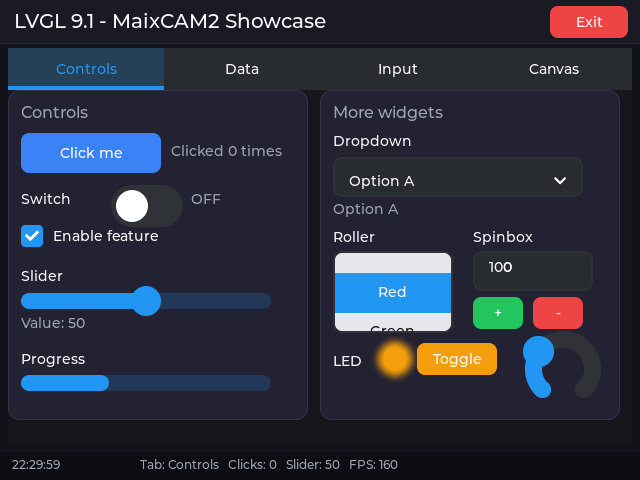
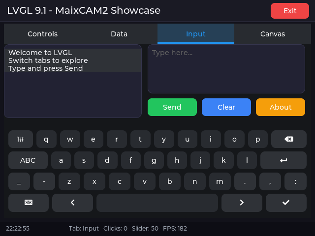
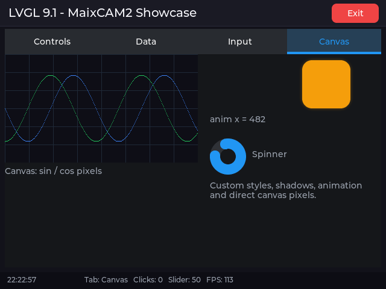
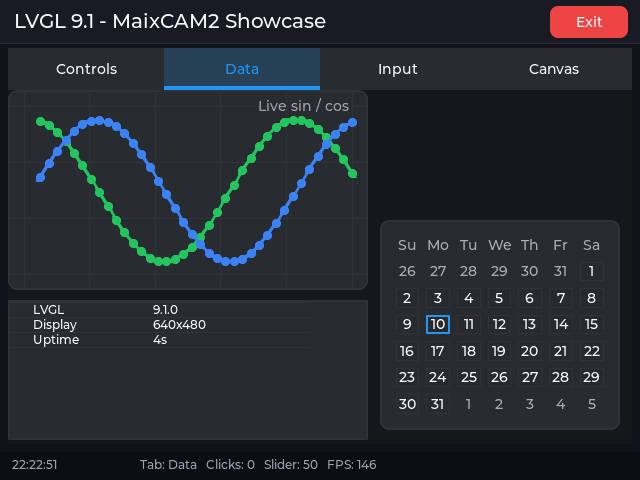
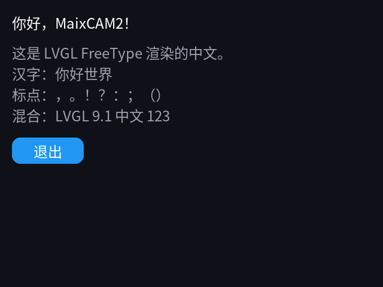
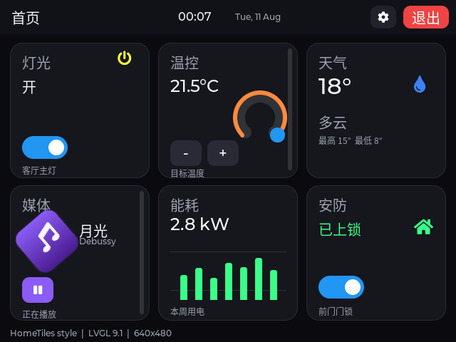
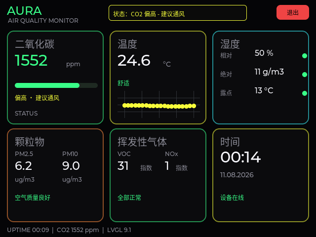
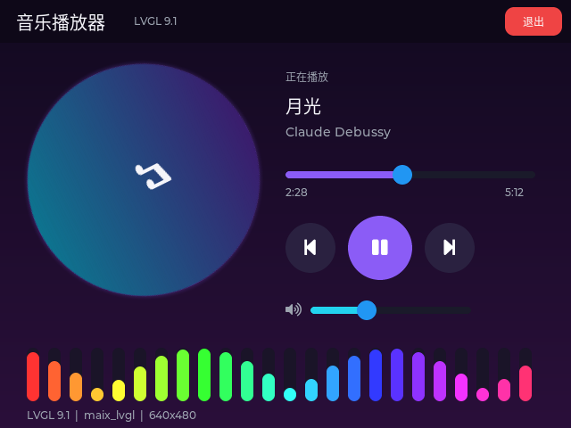
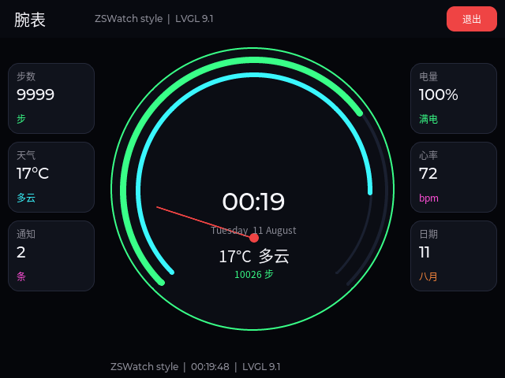

## 什么是 maix_lvgl

`maix_lvgl` 为 MaixPy 提供 [LVGL 9.1](https://lvgl.io/) 的 Python 绑定，API 与
MicroPython 的 `lvgl` 模块保持一致，可以直接用 `import maix_lvgl as lv` 编写界面。

它把 LVGL 渲染结果通过 `maix.display.Display` 显示到屏幕，并把
`maix.touchscreen.TouchScreen` 的触摸事件接入 LVGL 的指针输入设备，因此在
MaixCAM / MaixCAM2 上不需要额外的显示驱动代码。



主要特性：

- 完整的 LVGL 9.1 控件：按钮、标签、滑块、开关、下拉框、图表、画布、键盘等
- 样式系统：颜色、圆角、边框、阴影、渐变、字体
- 布局：绝对定位、对齐、Flex、Grid
- 事件、定时器、动画
- Canvas 逐像素绘制、Chart 实时曲线
- FreeType 运行时字体，可显示中文
- 纯 Python 主循环，易于和 MaixPy 的摄像头、AI、网络功能组合

> 仓库：<https://github.com/Taoxuan-168/Maix_LVGL>
>
> PyPI：<https://pypi.org/project/maix-lvgl/>

## 安装

在设备上直接通过 PyPI 安装，`pip` 会自动选择匹配平台的 wheel：

```bash
python3 -m pip install maix-lvgl
```

支持平台：

| 设备 | Python | wheel 标签 |
| --- | --- | --- |
| MaixCAM2 | 3.13 | `cp313-cp313-manylinux2014_aarch64` |
| MaixCAM | 3.11 | `cp311-musllinux_1_2_riscv64` |

也可以从 GitHub Release 下载 wheel 手动安装：

<https://github.com/Taoxuan-168/Maix_LVGL/releases>

验证安装：

```python
import maix_lvgl as lv
print(lv.__version__)
```

> 运行 LVGL 程序前需要停止 launcher 或进入开发模式，因为同一时间只能有一个
> 程序占用 `maix.display.Display`。

## 快速开始

下面是一个完整的可运行示例：创建屏幕、按钮和标签，处理点击事件，然后进入
LVGL 主循环。

```python
import time

from maix import app, display, touchscreen

import maix_lvgl as lv


def main():
    disp = display.Display()
    ts = touchscreen.TouchScreen()

    try:
        lv.init(disp, ts)

        scr = lv.screen_active()
        scr.set_style_bg_color(lv.color_hex(0x101018), 0)
        scr.set_style_bg_opa(lv.OPA.COVER, 0)

        btn = lv.button(scr)
        btn.set_size(240, 120)
        btn.center()
        btn.set_style_bg_color(lv.color_hex(0x2563EB), 0)
        btn.set_style_radius(16, 0)

        label = lv.label(btn)
        label.set_text("Hello MaixCAM2")
        label.center()
        label.set_style_text_color(lv.color_hex(0xFFFFFF), 0)

        def on_clicked(event):
            print("clicked")

        btn.add_event_cb(on_clicked, lv.EVENT.CLICKED, None)

        while not app.need_exit():
            lv.timer_handler()
            time.sleep(0.005)

    finally:
        lv.deinit()
        ts.close()
        disp.close()


if __name__ == "__main__":
    main()
```

要点：

- `lv.init(disp, ts)` 创建 LVGL 显示和触摸输入设备；传 `False` 可以关闭触摸。
- `lv.timer_handler()` 每次推进 LVGL tick 并处理定时器、输入和重绘。它已经
  代替了 `lv_tick_inc()`，不要直接调用原始 `lvgl.timer_handler()`。
- `lv.deinit()` 释放 LVGL 和它创建的驱动资源。
- 主循环中 `time.sleep(0.005)` 只是让出 CPU，LVGL 的实际刷新由
  `timer_handler()` 驱动。

## 核心概念

| 概念 | 说明 |
| --- | --- |
| display | LVGL 的显示设备，由 `lv.init()` 根据 MaixPy display 创建 |
| screen | 根对象，用 `lv.screen_active()` 获取，所有控件都挂在它下面 |
| widget / obj | 控件，如 `lv.button`、`lv.label`、`lv.slider`，第一个参数是父对象 |
| style | 样式属性，通过 `set_style_*` 设置，第二个参数是状态选择器 |
| event | 事件，通过 `add_event_cb()` 注册回调 |
| timer | LVGL 定时器，用 `lv.timer_create()` 创建 |
| anim | 动画，用 `lv.anim_t()` 创建并 `start()` |

LVGL 采用父子对象树：父对象删除时会自动删除子对象。Python 变量只是底层
LVGL 对象的包装，短期变量不会阻止控件显示；但回调函数、动画、Canvas 缓冲区
等需要保持 Python 引用，否则可能被垃圾回收。

## 创建控件

所有控件都以父对象为第一个参数：

```python
scr = lv.screen_active()

label = lv.label(scr)
button = lv.button(scr)
slider = lv.slider(scr)
switch = lv.switch(scr)
chart = lv.chart(scr)
canvas = lv.canvas(scr)
```

常用控件：

| 控件 | 用途 |
| --- | --- |
| `lv.label` | 文本 |
| `lv.button` | 按钮 |
| `lv.switch` / `lv.checkbox` | 开关 / 复选框 |
| `lv.slider` / `lv.bar` / `lv.arc` | 滑块 / 进度条 / 圆弧 |
| `lv.dropdown` / `lv.roller` | 下拉框 / 滚轮选择 |
| `lv.textarea` / `lv.keyboard` | 文本输入 / 屏幕键盘 |
| `lv.chart` | 折线图、柱状图、散点图 |
| `lv.table` / `lv.calendar` | 表格 / 日历 |
| `lv.canvas` | 逐像素绘制 |
| `lv.list` / `lv.msgbox` | 列表 / 消息框 |
| `lv.spinner` / `lv.led` | 加载动画 / LED 指示灯 |

### 控件常用操作

```python
label = lv.label(scr)
label.set_text("温度: 25.3 °C")
label.set_pos(20, 20)
label.set_style_text_color(lv.color_hex(0xE5E7EB), 0)
label.set_style_text_font(lv.font_montserrat_16, 0)

slider = lv.slider(scr)
slider.set_pos(20, 60)
slider.set_size(220, 16)
slider.set_range(0, 100)
slider.set_value(50, lv.ANIM_ENABLE.OFF)

bar = lv.bar(scr)
bar.set_pos(20, 100)
bar.set_size(220, 12)
bar.set_range(0, 100)
bar.set_value(65, lv.ANIM_ENABLE.OFF)

switch = lv.switch(scr)
switch.set_pos(20, 130)
switch.add_state(lv.STATE.CHECKED)
```



`set_value()` 的第二个参数传入 `lv.ANIM_ENABLE.OFF` 可以立即生效；传入
`lv.ANIM_ENABLE.ON` 会使用默认动画过渡。

## 样式

LVGL 的样式通过 `set_style_*` 方法直接设置在对象上。第二个参数是选择器：

- `0`：主部件（`LV_PART_MAIN`）的默认状态
- `lv.STATE.PRESSED`：按下状态
- `lv.STATE.CHECKED`：选中状态

### 颜色与透明度

```python
color = lv.color_hex(0x3B82F6)          # RGB
scr.set_style_bg_color(color, 0)
scr.set_style_bg_opa(lv.OPA.COVER, 0)   # 完全不透明

panel.set_style_bg_opa(lv.OPA._70, 0)   # 70% 不透明度
```

`lv.OPA` 提供 `TRANSP`、`_10` 到 `_90`、`COVER` 等常用值。

### 圆角、边框、阴影

```python
card = lv.obj(scr)
card.set_size(220, 120)
card.set_style_bg_color(lv.color_hex(0x1E293B), 0)
card.set_style_bg_opa(lv.OPA.COVER, 0)
card.set_style_radius(14, 0)
card.set_style_border_width(1, 0)
card.set_style_border_color(lv.color_hex(0x334155), 0)
card.set_style_shadow_width(18, 0)
card.set_style_shadow_color(lv.color_hex(0x3B82F6), 0)
card.set_style_shadow_opa(lv.OPA._50, 0)
card.set_style_pad_all(12, 0)
```

### 渐变背景

```python
card.set_style_bg_color(lv.color_hex(0x0F172A), 0)
card.set_style_bg_grad_color(lv.color_hex(0x1E3A8A), 0)
card.set_style_bg_grad_dir(lv.GRAD_DIR.VER, 0)
```

### 文本样式

```python
label.set_style_text_color(lv.color_hex(0xF8FAFC), 0)
label.set_style_text_font(lv.font_montserrat_20, 0)
label.set_style_text_letter_space(2, 0)
```

内置 Montserrat 字体只覆盖拉丁字符；中文需要 FreeType，见下文。

### 状态样式

同一个对象可以为不同状态设置不同样式：

```python
btn.set_style_bg_color(lv.color_hex(0x2563EB), 0)
btn.set_style_bg_color(lv.color_hex(0x1D4ED8), lv.STATE.PRESSED)
```

## 布局与对齐

### 绝对定位

```python
obj.set_pos(x, y)
obj.set_x(x)
obj.set_y(y)
obj.set_size(width, height)
```

### 对齐

```python
obj.align(lv.ALIGN.CENTER, 0, 0)
obj.align(lv.ALIGN.TOP_RIGHT, -10, 10)
obj.center()
```

`lv.ALIGN` 包含 `TOP_LEFT`、`TOP_MID`、`CENTER`、`BOTTOM_RIGHT` 等 20 多种
对齐方式；后两个参数是相对目标位置的偏移。

### Flex 布局

Flex 适合做一行或一列自动排列的控件：

```python
row = lv.obj(scr)
row.set_size(400, 80)
row.set_flex_flow(lv.FLEX_FLOW.ROW)
row.set_flex_align(
    lv.FLEX_ALIGN.SPACE_EVENLY,
    lv.FLEX_ALIGN.CENTER,
    lv.FLEX_ALIGN.CENTER,
)

for text in ("A", "B", "C"):
    btn = lv.button(row)
    btn.set_size(80, 48)
    lv.label(btn).set_text(text)
```

### Grid 布局

Grid 适合表格状布局。`set_grid_dsc_array()` 接受列和行的尺寸数组，数组末尾
需要 `LV_GRID_TEMPLATE_LAST` 结束标记（当前绑定没有导出这个常量，LVGL 9.1
中它的值是 `0x1FFFFFFF`）：

```python
GRID_LAST = 0x1FFFFFFF  # LV_GRID_TEMPLATE_LAST

grid = lv.obj(scr)
grid.set_size(300, 200)
grid.set_grid_dsc_array(
    [lv.grid_fr(1), lv.grid_fr(1), GRID_LAST],
    [lv.grid_fr(1), lv.grid_fr(1), GRID_LAST],
)

item = lv.obj(grid)
item.set_grid_cell(lv.GRID_ALIGN.STRETCH, 0, 1, lv.GRID_ALIGN.STRETCH, 0, 1)
```

## 事件

事件回调的签名是 `callback(event)`，`event` 是 `event_t`：

```python
def on_clicked(event):
    target = event.get_target_obj()
    print("clicked", target)

btn.add_event_cb(on_clicked, lv.EVENT.CLICKED, None)
```

常用事件：

| 事件 | 触发条件 |
| --- | --- |
| `lv.EVENT.CLICKED` | 点击 |
| `lv.EVENT.PRESSED` / `RELEASED` | 按下 / 松开 |
| `lv.EVENT.VALUE_CHANGED` | 值变化（滑块、开关、下拉框） |
| `lv.EVENT.READY` | 操作完成（键盘、消息框） |

滑块和开关示例：

```python
def on_value_changed(event):
    print("value:", slider.get_value())

slider.add_event_cb(on_value_changed, lv.EVENT.VALUE_CHANGED, None)


def on_switch_changed(event):
    print("switch:", switch.has_state(lv.STATE.CHECKED))

switch.add_event_cb(on_switch_changed, lv.EVENT.VALUE_CHANGED, None)
```

> 回调函数要保持在 Python 作用域内（模块级、闭包或列表），不要用临时
> lambda 后立即丢弃。`add_event_cb` 的第三个参数是 user_data，可以传任意
> Python 对象，回调中通过 `event.get_user_data()` 获取。

移除回调：

```python
btn.remove_event_cb(on_clicked)
```

## 定时器与动画

### 定时器

```python
def on_tick(timer):
    label.set_text(time.strftime("%H:%M:%S"))

timer = lv.timer_create(on_tick, 1000, None)  # 每 1000 ms
```

`lv.timer_create(callback, period_ms, user_data)` 创建后自动运行。回调函数和
`timer` 对象都要保持引用；不再需要时调用 `timer.delete()`。

### 动画

```python
box = lv.obj(scr)
box.set_size(80, 80)
box.set_style_bg_color(lv.color_hex(0xF59E0B), 0)
box.set_style_bg_opa(lv.OPA.COVER, 0)
box.set_style_radius(16, 0)

def exec_anim(anim, value):
    box.set_x(value)

anim = lv.anim_t()
anim.init()
anim.set_values(0, 240)
anim.set_time(1200)
anim.set_playback_time(1200)
anim.set_repeat_count(0xFFFF)   # 无限循环
anim.set_custom_exec_cb(exec_anim)
anim.start()
```

`set_values(start, end)` 设置起止值，`set_time()` 是正程时间，
`set_playback_time()` 是回程时间。`anim` 对象必须保持引用。

也可以使用 `maix_lvgl` 提供的 `lv.anim_set_exec_cb(anim, cb)` 辅助函数。

## 绘制

### Canvas 逐像素绘制

`lv.canvas` 允许直接操作像素，适合波形、仪表盘、自定义图形：

```python
import math

WIDTH, HEIGHT = 320, 180
buffer = bytearray(WIDTH * HEIGHT * 4)   # ARGB8888

canvas = lv.canvas(scr)
canvas.set_size(WIDTH, HEIGHT)
canvas.set_buffer(buffer, WIDTH, HEIGHT, lv.COLOR_FORMAT.ARGB8888)
canvas.fill_bg(lv.color_hex(0x0E0E16), lv.OPA.COVER)

grid_color = lv.color_hex(0x1F2937)
for x in range(0, WIDTH, 40):
    for y in range(HEIGHT):
        canvas.set_px(x, y, grid_color, lv.OPA.COVER)

wave_color = lv.color_hex(0x3B82F6)
for x in range(WIDTH):
    y = int(HEIGHT / 2 + 55 * math.sin(x / 24.0))
    if 0 <= y < HEIGHT:
        canvas.set_px(x, y, wave_color, lv.OPA.COVER)
```



要点：

- `set_buffer()` 的缓冲区必须是 `bytearray`，像素格式为 `ARGB8888`。
- **缓冲区必须保持 Python 引用**（例如模块级变量或列表），否则被回收后
  canvas 会显示花屏或崩溃。
- 缓冲区大小按 `width * height * 4` 计算。
- 修改像素后 LVGL 会在下一次重绘时刷新。

### Chart 实时曲线

```python
import math

chart = lv.chart(scr)
chart.set_size(360, 200)
chart.set_type(lv.chart.TYPE.LINE)
chart.set_point_count(40)
chart.set_range(lv.chart.AXIS.PRIMARY_Y, -100, 100)
chart.set_div_line_count(4, 6)
chart.set_update_mode(lv.chart.UPDATE_MODE.SHIFT)

series = chart.add_series(lv.color_hex(0x22C55E), lv.chart.AXIS.PRIMARY_Y)

for i in range(40):
    chart.set_next_value(series, int(80 * math.sin(i / 5.0)))
```



`set_update_mode(lv.chart.UPDATE_MODE.SHIFT)` 让新数据从左侧移入，适合实时
显示。也可以使用 `lv.chart.TYPE.BAR` 绘制柱状图。

### 样式绘制

很多“绘制”效果可以直接用样式完成，不需要 Canvas：

- 边框：`set_style_border_width()` + `set_style_border_color()`
- 圆角：`set_style_radius()`
- 阴影/发光：`set_style_shadow_width()` + `set_style_shadow_color()` +
  `set_style_shadow_opa()`
- 渐变：`set_style_bg_grad_color()` + `set_style_bg_grad_dir()`
- 圆弧/进度：`lv.arc`、`lv.bar`

```python
ring = lv.arc(scr)
ring.set_size(120, 120)
ring.set_bg_angles(0, 360)
ring.set_angles(0, 270)
ring.set_style_arc_color(lv.color_hex(0x22C55E), lv.PART.INDICATOR)
ring.set_style_arc_width(10, lv.PART.INDICATOR)
```

### 中文文字（FreeType）

内置 Montserrat 字体只有拉丁字符。要显示中文，使用 FreeType 在运行时加载
系统字体：

```python
FONT = "/maixapp/share/font/SourceHanSansCN-Regular.otf"

font = lv.freetype_font_create(FONT, 0, 24, 0)
if font is None:
    raise RuntimeError("cannot load " + FONT)

label = lv.label(scr)
label.set_text("你好，MaixCAM2！")
label.set_style_text_font(font, 0)
label.set_pos(20, 20)

# 先删除使用该字体的控件，再删除字体
label.delete()
font.freetype_font_delete()
```



注意事项：

- `lv.init()` 已经初始化 FreeType，`lv.deinit()` 会清理；不要手动调用
  `lv.freetype_init()` / `lv.freetype_uninit()`，否则可能重复清理导致卡死。
- 删除控件顺序：先删除所有使用字体的控件，再调用
  `font.freetype_font_delete()`。
- 字体文件约 8 MB，按需创建；字形缓存由 `LV_FREETYPE_CACHE_SIZE` 控制。

### 图片

LVGL 用 `lv.image` 控件显示图片，`set_src()` 接受图片描述符或路径。显示
MaixPy 摄像头图像时，通常把图像转换为 `ARGB8888`/`BGRA8888` 缓冲区，再用
`lv.image_dsc_t` 包装：

```python
dsc = lv.image_dsc_t()
dsc.header.w = width
dsc.header.h = height
dsc.header.cf = lv.COLOR_FORMAT.ARGB8888
dsc.data_size = len(buffer)
dsc.data = buffer

img = lv.image(scr)
img.set_src(dsc)
```

> `image_dsc_t` 的 `data` 缓冲区必须保持引用；如果使用 MaixPy 的 `image`
> 对象，先转换为 BGRA8888 再取字节。完整示例见仓库
> `examples/showcase.py` 和 `examples/music_player.py`。

## 与 MaixPy 组合

`maix_lvgl` 只负责 UI，摄像头、AI、网络等继续使用 MaixPy 的模块。常见的
组合方式：

```python
from maix import app, camera, display, touchscreen
import maix_lvgl as lv

cam = camera.Camera(320, 240)
disp = display.Display()
ts = touchscreen.TouchScreen()

lv.init(disp, ts)
# ... 创建 UI ...

while not app.need_exit():
    img = cam.read()
    # 把 img 传给 AI 或网络模块，结果更新到 LVGL 控件
    lv.timer_handler()
    time.sleep(0.005)
```

UI 线程和摄像头读取都在主循环中串行执行，避免多线程同时操作 LVGL。

## 性能与注意事项

- **全屏缓冲区**：`DisplayDriver` 使用 `width * height * 4` 字节的整屏
  buffer（640×480 约 1.2 MB），`FULL` 渲染模式，flush 时整帧推送。
- **主循环**：建议 `lv.timer_handler()` 后 `sleep(0.005)`；LVGL 只在有变化时
  重绘。
- **对象生命周期**：回调、动画、timer、canvas buffer 必须保持 Python 引用。
- **触摸区域**：触摸事件按控件实际区域命中，控件需要覆盖用户点击的位置。
- **单一 display**：同一时间只能有一个程序使用 `maix.display.Display`；运行
  前停止 launcher。
- **字体缓存**：FreeType 字形缓存有限，频繁切换大字号时注意内存。

## 从源码编译 maix_lvgl（简要）

`maix_lvgl` 是一个标准 MaixCDK 项目，LVGL 源码不随仓库分发，由 MaixCDK 按
其 Kconfig 固定版本下载并编译。

流程：

1. MaixCDK 下载并编译 LVGL 9.1.0（含 FreeType、rlottie 等依赖）。
2. `tools/regenerate_binding.py` 用内置的 omnipython-lvgl 生成器，从 MaixCDK
   的 LVGL 头文件生成 `binding/lvgl_python.c` 和 `binding/lvgl.pyi`。
3. `components/lvgl_binding` 把生成代码和 `runtime/lvpy_runtime.c` 编译成
   `liblvgl_binding.so`，链接 MaixCDK 的 LVGL 和 Python。
4. `setup.py` 把扩展、Python 后端和依赖打包成目标平台的 wheel。

构建命令：

```bash
export MAIXCDK_PATH=/path/to/MaixCDK

# MaixCAM2：aarch64 / Python 3.13
python3.13 setup.py bdist_wheel --board maixcam2

# MaixCAM：RISC-V / Python 3.11
python3.11 setup.py bdist_wheel --board maixcam
```

依赖：MaixCDK、对应 host Python（3.13 或 3.11）、`pycparser`、`cmake`、目标
交叉工具链。生成物在 `dist/` 下：

```text
maix_lvgl-0.1.0-cp313-cp313-manylinux2014_aarch64.whl
maix_lvgl-0.1.0-cp311-cp311-musllinux_1_2_riscv64.whl
```

完整的构建、绑定再生成和发布说明见仓库 `README.md` 与
`docs/PUBLISHING.md`。

## 示例与仓库

仓库：<https://github.com/Taoxuan-168/Maix_LVGL>

| 示例 | 内容 |
| --- | --- |
| `examples/demo.py` | 最小按钮示例 |
| `examples/showcase.py` | 四页控件、图表、输入、Canvas 演示 |
| `examples/tile_dashboard.py` | 智能家居卡片面板 |
| `examples/neon_dashboard.py` | 霓虹风格仪表盘 |
| `examples/music_player.py` | 音乐播放器、频谱 |
| `examples/watchface.py` | 圆形表盘 |
| `tests/suite_*.py` | 设备端 API 测试套件 |

### 界面示例









在设备上运行示例：

```bash
python examples/showcase.py
```

使用 on-screen 的 **Exit** 按钮退出。
