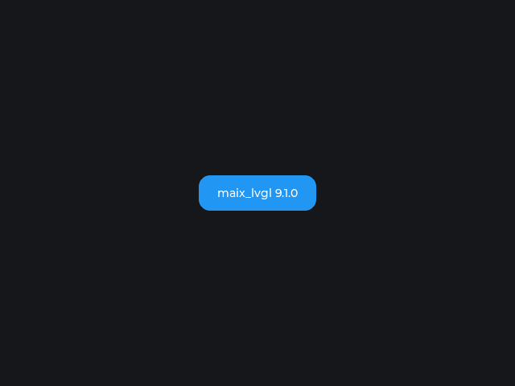

# maix_lvgl

[中文文档](README_ZH.md) | English

LVGL bindings for MaixPy on MaixCAM2 with the MicroPython-style API. This is a
standard **MaixCDK project**: the LVGL library is downloaded and built by
MaixCDK, the binding is generated from that source, and `setup.py` packages the
result the same way MaixPy does.



*Rendered by MaixCAM2 through `maix.display.Display` (640×480, BGRA8888).*

The binding is generated with the generator from
[PyDevices/omnipython-lvgl](https://github.com/PyDevices/omnipython-lvgl)
(MIT), vendored under `tools/omnipython_lvgl/`.

Prebuilt wheel: [Releases](https://github.com/Taoxuan-168/Maix_LVGL/releases).

## Quick start

```python
import time
from maix import app, display, touchscreen
import maix_lvgl as lv

disp = display.Display()
ts = touchscreen.TouchScreen()

try:
    lv.init(disp, ts)               # pass MaixPy display + touchscreen

    scr = lv.screen_active()
    btn = lv.button(scr)            # same style as MicroPython's lvgl
    btn.set_size(240, 120)
    btn.center()
    label = lv.label(btn)
    label.set_text("Hello MaixCAM2")

    btn.add_event_cb(lambda e: print("clicked"), lv.EVENT.CLICKED, None)

    while not app.need_exit():
        lv.timer_handler()          # maix_lvgl version: advances the LVGL tick
        time.sleep(0.005)
finally:
    lv.deinit()
    ts.close()
    disp.close()
```

## Standard MaixCDK project layout

```
maix_lvgl/
├── CMakeLists.txt           # MaixCDK project entry
├── project.py               # MaixCDK build driver
├── Kconfig                  # project config
├── main/                    # entry component (depends on lvgl_binding)
├── components/lvgl_binding/ # LVGL CPython extension component
│   ├── CMakeLists.txt       # links MaixCDK's lvgl + python3, generates binding
│   ├── component.py         # add_requirements: lvgl, python3
│   └── Kconfig
├── binding/                 # generated C binding + pyi + lv_conf.h
├── runtime/                 # CPython runtime glue (lvpy_runtime.c/h)
├── maix_lvgl/               # Python backend + built extension (in the wheel)
├── tools/
│   ├── maixcdk_lvgl.py      # locate MaixCDK / its LVGL source
│   ├── regenerate_binding.py# regenerate binding from MaixCDK's LVGL (stamped)
│   └── omnipython_lvgl/     # vendored generator (MIT)
├── configs/config_platform_maixcam2.mk
├── setup.py                 # project.py build + wheel packaging (like MaixPy)
└── dist/
```

`components/lvgl_binding` declares `ADD_REQUIREMENTS lvgl python3`, so
MaixCDK downloads its pinned LVGL (9.1.0 today, from
`components/3rd_party/lvgl/Kconfig`), compiles it together with the rest of
the stack, and the binding links against that exact library.

## Building

```bash
export MAIXCDK_PATH=/path/to/MaixCDK
python3 setup.py bdist_wheel
```

What happens:

1. `setup.py` runs `python project.py build -p maixcam2 --release` (same
   pattern as MaixPy's `setup.py`).
2. MaixCDK downloads its LVGL source and dependencies (first build), then the
   `lvgl_binding` component's custom target regenerates
   `binding/lvgl_python.c` from that source when it changed.
3. The component compiles and links against MaixCDK's `lvgl` and `python3`
   components with MaixCDK's cross toolchain.
4. The wheel is packaged as `cp313-manylinux2014_aarch64`:
   `maix_lvgl/` contains `__init__.py`, `driver.py`,
   `lvgl.cpython-313-aarch64-linux-gnu.so` and `dl_lib/libdatachannel.so`.

The build also generates MaixPy-style API documentation from
`binding/lvgl.pyi` into `docs/api/` (`api.json`, `config.json`, `README.md`,
`README2.md`, `sidebar.yaml` and `maix_lvgl/{lvgl,maix_lvgl}.md`), the same
build-time flow as MaixPy's `components/maix/gen_api.py` -> `docs/api/maix`.
The generated docs are a build artifact and are not tracked in git; run
`python3 tools/gen_api_docs.py` to regenerate them alone.

Build requirements: MaixCDK with MaixCAM2 toolchain/Python headers under
`dl/extracted`, **cmake 3.x** (MaixCDK's freetype subproject rejects cmake 4),
`pycparser` (`pip install 'pycparser>=3.0'`), host `gcc`, and network access
for the first dependency download.

Binding regeneration is cached in `binding/.binding_stamp.json` and runs
automatically during `project.py build`. Force it with:

```bash
python3 tools/regenerate_binding.py --force
# or
./scripts/regenerate_binding.sh
```

`--skip-build` reuses the existing MaixCDK build when re-packaging:

```bash
python3 setup.py bdist_wheel --skip-build
```

## Configuration notes

The binding uses MaixCDK's LVGL `lv_conf.h` as-is (so struct layouts match the
library MaixCDK compiles): `LV_USE_OS=LV_OS_PTHREAD`, `LV_USE_RLOTTIE=1`,
`LV_COLOR_DEPTH=32`. Two build-system-only bits are removed
(`global_config.h` include and the `lv_ui_mutex_*` declarations), and the
generated C has Python access stripped from fields whose types are
`pthread_mutex_t` (`lv_thread_sync_t`, `lv_draw_global_info_t.circle_cache_mutex`,
`lv_cache_t.lock`), which have no Python representation.

MaixCAM2's display only accepts BGRA8888, which is byte-identical to LVGL's
little-endian ARGB8888 output; `FMT_RGB565` is rejected by the display driver.

## Tick and main loop

`lv_tick_set_cb()` cannot be used from the generated CPython binding: that API
takes no `user_data`, so the Python callback is not kept alive and the tick
stays at 0 (no LVGL timer, including the indev read timer, ever fires).
`maix_lvgl.timer_handler()` advances `lv_tick_inc()` on the main thread before
calling LVGL's timer handler; the re-exported `lv.timer_handler` already
points to it.

Do not call the raw `lvgl.timer_handler()` unless you advance `lv_tick_inc()`
yourself.

## Verified

- Wheel built through MaixCDK's `project.py`, installed on MaixCAM2
  (MaixPy 4.12.5) from inside `maix_lvgl/`; 640×480 BGRA8888 rendering
  confirmed by screenshot.
- Touch indev: 25 read callbacks in 50 timer-handler passes; manual
  `indev.read()` also wired correctly.
- Earlier builds of the same backend: 74 consecutive `lv.EVENT.CLICKED`
  hits, clean `lv.deinit()`.

## Known limitations

- **JPEG images**: upstream jpegio depends on LVGL 9.5 image-cache internals
  that do not exist in 9.1.0, so it is not compiled.
- **Chinese text**: only Montserrat fonts are enabled (MaixCDK's LVGL config).
- **Touch targets**: touch is verified; widgets must cover the actual touched
  area.
- **Display ownership**: only one `maix.display.Display` user at a time; stop
  the launcher/other apps before `lv.init()`.
