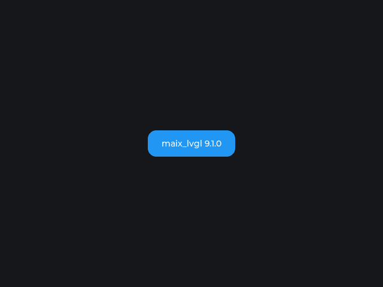

# maix_lvgl

[English](README.md) | 中文

面向 MaixPy（MaixCAM2）的 LVGL 绑定，API 与 MicroPython 的 `lvgl` 写法一致。
本项目是一个**标准 MaixCDK 工程**：LVGL 由 MaixCDK 自动下载并编译，绑定基于
MaixCDK 的 LVGL 源码生成，`setup.py` 按 MaixPy 的方式打包 wheel。



*由 MaixCAM2 通过 `maix.display.Display` 实际渲染（640×480，BGRA8888）。*

绑定生成参考并使用了 [PyDevices/omnipython-lvgl](https://github.com/PyDevices/omnipython-lvgl)
的生成器（MIT 协议，已内置在 `tools/omnipython_lvgl/`）。

预构建 wheel：[Releases](https://github.com/Taoxuan-168/Maix_LVGL/releases)。

## 快速开始

```python
import time
from maix import app, display, touchscreen
import maix_lvgl as lv

disp = display.Display()
ts = touchscreen.TouchScreen()

try:
    lv.init(disp, ts)               # 直接传入 MaixPy 屏幕和触摸屏

    scr = lv.screen_active()
    btn = lv.button(scr)            # 与 MicroPython 写法一致
    btn.set_size(240, 120)          # 按钮大一些，方便点击
    btn.center()
    label = lv.label(btn)
    label.set_text("Hello MaixCAM2")

    btn.add_event_cb(lambda e: print("clicked"), lv.EVENT.CLICKED, None)

    while not app.need_exit():
        lv.timer_handler()          # maix_lvgl 版本：自动推进 tick
        time.sleep(0.005)
finally:
    lv.deinit()
    ts.close()
    disp.close()
```

## 标准 MaixCDK 工程结构

```
maix_lvgl/
├── CMakeLists.txt           # MaixCDK 工程入口
├── project.py               # MaixCDK 构建驱动
├── Kconfig                  # 工程配置
├── main/                    # 入口组件（依赖 lvgl_binding）
├── components/lvgl_binding/ # LVGL CPython 扩展组件
│   ├── CMakeLists.txt       # 链接 MaixCDK 的 lvgl + python3，并生成绑定
│   ├── component.py         # add_requirements: lvgl, python3
│   └── Kconfig
├── binding/                 # 生成的 C 绑定 + pyi + lv_conf.h
├── runtime/                 # CPython 运行时胶水（lvpy_runtime.c/h）
├── maix_lvgl/               # Python 后端 + 构建出的扩展（wheel 中）
├── tools/
│   ├── maixcdk_lvgl.py      # 定位 MaixCDK 及其 LVGL 源码
│   ├── regenerate_binding.py# 从 MaixCDK 的 LVGL 重新生成绑定（带 stamp 缓存）
│   └── omnipython_lvgl/     # 内置生成器（MIT）
├── configs/config_platform_maixcam2.mk
├── setup.py                 # project.py build + wheel 打包（模仿 MaixPy）
└── dist/
```

`components/lvgl_binding` 通过 `ADD_REQUIREMENTS lvgl python3` 依赖 MaixCDK 的
LVGL 组件：MaixCDK 会自动下载其 Kconfig 固定的 LVGL（当前 9.1.0）、编译整条
依赖栈，绑定则链接这份实际的 LVGL 库。

## 构建

```bash
export MAIXCDK_PATH=/path/to/MaixCDK
python3 setup.py bdist_wheel
```

流程：

1. `setup.py` 调用 `python project.py build -p maixcam2 --release`（与 MaixPy
   的 `setup.py` 相同模式）。
2. MaixCDK 下载其 LVGL 源码和依赖（首次构建）；`lvgl_binding` 组件的自定义
   目标在源码变化时从 MaixCDK 的 LVGL 重新生成 `binding/lvgl_python.c`。
3. 组件用 MaixCDK 的交叉工具链编译，并链接 MaixCDK 的 `lvgl`、`python3`
   组件。
4. 打包为 `cp313-manylinux2014_aarch64` wheel：`maix_lvgl/` 内包含
   `__init__.py`、`driver.py`、`lvgl.cpython-313-aarch64-linux-gnu.so` 和
   `dl_lib/libdatachannel.so`。

构建时还会从 `binding/lvgl.pyi` 生成 MaixPy 风格的 API 文档到 `docs/api/`
（`api.json`、`config.json`、`README.md`、`README2.md`、`sidebar.yaml`，以及
`maix_lvgl/{lvgl,maix_lvgl}.md` 模块页），与 MaixPy 的
`components/maix/gen_api.py` → `docs/api/maix` 采用相同的构建时流程；
生成物不纳入 git，可单独运行 `python3 tools/gen_api_docs.py` 重新生成。

构建要求：带 MaixCAM2 工具链/Python 头文件的 MaixCDK（`dl/extracted` 下）、
**cmake 3.x**（MaixCDK 的 freetype 子工程不兼容 cmake 4）、`pycparser`
（`pip install 'pycparser>=3.0'`）、宿主 `gcc`，以及首次下载依赖的网络。

绑定重新生成带缓存（`binding/.binding_stamp.json`），在 `project.py build`
时自动执行。强制重生成：

```bash
python3 tools/regenerate_binding.py --force
# 或
./scripts/regenerate_binding.sh
```

打包时复用已有 MaixCDK 构建可用：

```bash
python3 setup.py bdist_wheel --skip-build
```

## 配置说明

绑定直接使用 MaixCDK 的 LVGL `lv_conf.h`（保证与 MaixCDK 编译出的库结构体
一致）：`LV_USE_OS=LV_OS_PTHREAD`、`LV_USE_RLOTTIE=1`、`LV_COLOR_DEPTH=32`。
仅移除两处构建系统专用的内容（`global_config.h` include 和
`lv_ui_mutex_*` 声明）；生成后的 C 会去掉 `pthread_mutex_t` 类型字段的 Python
访问（`lv_thread_sync_t`、`lv_draw_global_info_t.circle_cache_mutex`、
`lv_cache_t.lock`），因为这些类型无法映射到 Python。

MaixCAM2 的显示只接受 BGRA8888，而 LVGL 在小端平台 ARGB8888 的字节顺序正好是
B,G,R,A，与 `FMT_BGRA8888` 一致；显示驱动不接受 `FMT_RGB565`。

## tick 与主循环

`lv_tick_set_cb()` 在生成的 CPython 绑定中不可用：该 API 没有 `user_data`
参数，Python 回调无法被保持，`lv_tick_get()` 会一直是 0，导致 LVGL 的全部
定时器（包括触摸 indev 的读取定时器）都不运行。

因此 `maix_lvgl.timer_handler()` 会在主线程先按单调时间推进
`lv.tick_inc()`，再调用 LVGL 的 `timer_handler()`。重导出的
`lv.timer_handler` 已指向该版本。

不要直接调用原生 `lvgl.timer_handler()`，除非你自己推进 `lv.tick_inc()`。

## 已验证

- 通过 MaixCDK 的 `project.py` 构建 wheel，安装到 MaixCAM2（MaixPy 4.12.5）
  后从 `maix_lvgl/` 包内加载扩展；640×480 BGRA8888 渲染截图正常。
- 触摸 indev：50 次 timer_handler 触发 25 次 read 回调；手动 `indev.read()`
  也正常。
- 同一后端较早的构建：连续 74 次 `lv.EVENT.CLICKED` 命中、`lv.deinit()` 正常。

## 已知限制

- **JPEG 图片**：上游 jpegio 依赖 LVGL 9.5 的 image-cache 内部结构，LVGL 9.1.0
  中不存在，因此未编译。
- **中文显示**：只启用了 Montserrat 字体（MaixCDK 的 LVGL 配置如此）。
- **点击目标**：触摸已验证，但控件本身要覆盖你实际触摸的区域。
- **显示独占**：同一时间只能有一个 `maix.display.Display` 使用者，运行前需停止
  launcher 或其他应用。
